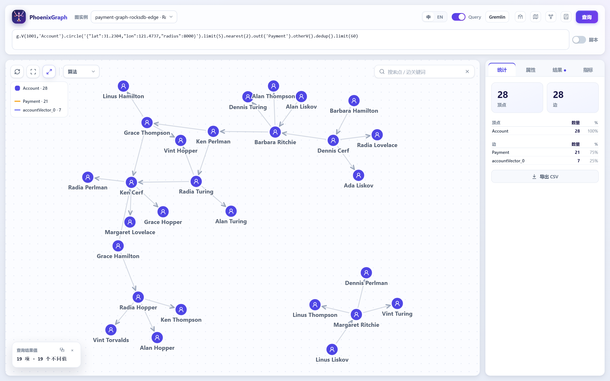
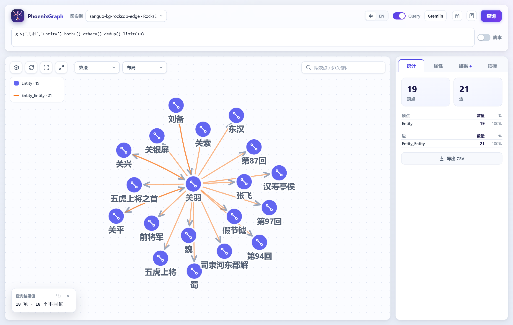
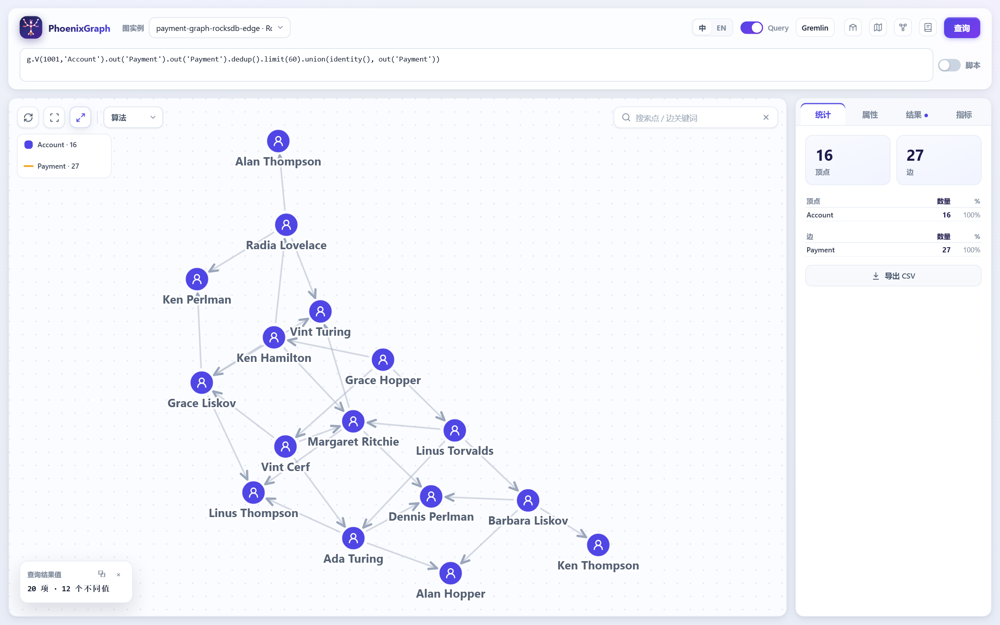
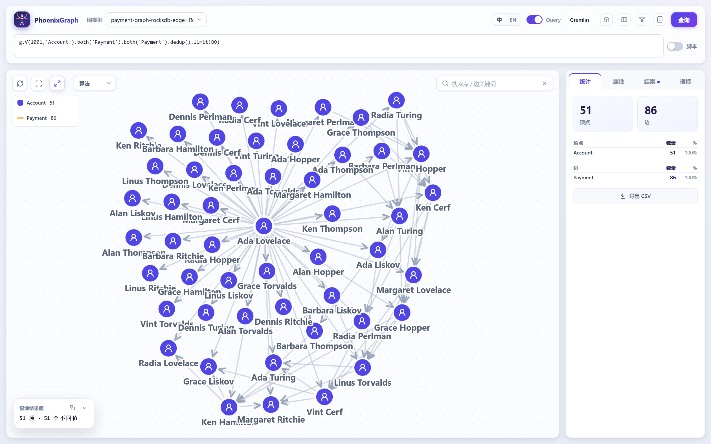

# PhoenixGraph

A high-scale, high-performance **HTAP graph database** that puts **graph traversal, vector search and
geo search** behind one query, and serves **knowledge graphs as context for AI agents**.

## What PhoenixGraph is

- **AI context graphs.** A knowledge graph is what an LLM needs to answer accurately: typed entities,
  typed relations with provenance, and question-shaped query templates. The worked example in this
  repository is the 《三国演义》 (Romance of the Three Kingdoms) graph - one unified schema serves a
  whole domain, and a query answers "关羽 and 诸葛亮: how are they related?" from the graph instead of
  from the model's memory alone.
- **One query over graph, vector and geo.** A vector hit and a geo hit are ordinary traversers, so
  "the five entities nearest me, their lookalikes, and what they are connected to" is one traversal,
  not three round trips from an application. See [below](#one-query-over-vector-geo-and-the-graph).
- **HTAP: OLTP on Aerospike, OLAP on RocksDB.** The transactional side answers a request by key in one
  record (or one batch); the analytical side scans a class in ordered tables, runs graph algorithms
  in-process or on a Gemini cluster. The backend is a property of the **schema**, so the same graph
  definition, the same Gremlin, the same openCypher and the same HTTP API are served by any scheme.
- **High performance and high QPS.** Keyed reads never scan; a hop reads its edges in one batched,
  cached, projected round trip; a compiled query is cached; a set of seeds is read in parallel; an
  attribute condition and a degree cap are pushed into the storage decode. Measured on the demo graph:
  a one-hop query p50 **0.54-3.57 ms** (median 0.9 ms), two hops **1.22-5.16 ms** (median 2.3 ms)
  (`AerospikeHopQueryLatencyTest`).
- **Visualization.** `graph-web` renders the induced subgraph a query returned - the engine returns it
  with full properties for exactly this - colours it with graph algorithms, and edits schemas and fuzzy
  patterns in a builder page.
- **Fraud rings from fragments.** `fuzzyLink(patternId, context)` turns the small details several
  accounts share (an email provider, an IP /16, a card BIN, a user-name *shape*) into a link node, so a
  query walks from the pattern to the ring (`graph-fuzzy` holds the pattern language and the
  deterministic ids). A pattern is data (`fuzzy-patterns.json`), editable while the service runs.

### Limitations — what this is *not* (read this before deploying)

This is **1.0 in the sense that a stranger can run it and re-derive every number in this document**, not in the
sense of feature-complete or proven at scale. The gaps are known and tracked in
[docs/ROADMAP-1.0.md](docs/ROADMAP-1.0.md); [docs/RELEASE-1.0.0.md](docs/RELEASE-1.0.0.md) has the full list.
The short version:

- **Authentication and TLS exist but are off by default.** With `phoenixgraph.security.enabled=true` every
  `/api` call needs a key (roles reader/writer/admin, optional per-graph scoping, every call audited, tokens
  never logged) - the default is `false` so the UI, the demo and the verification suite work without ceremony,
  which means **an instance you did not configure is open to anyone who can reach the port**. HTTPS is one
  configuration block away (`server.ssl.*` with a keystore, password from the environment - `docs/API.md` §2).
  Turn both on before exposing the service. Error bodies no longer carry stack traces (that is the
  `phoenixgraph.errors.include-stack-trace` default), and the audit trail is a bounded in-memory ring plus the
  log, so it does not survive a restart.
- **Replication exists, failover is manual.** `deploy/aerospike-cluster/` runs a two-node cluster with
  replication factor 2, and `verification/verify-aerospike-ha.mjs` shows what it buys: killing a node costs
  **1 s** of failover and no correctness, writes continue while it is down, and it rejoins in 2 s. But the
  engine takes **one storage seed**, so a *restart* while that seed is down does not connect (a running node
  reconnects by itself) - point `phoenixgraph.storage.host` at a load-balanced address for that. RocksDB is a
  single-writer store on a local or shared volume, and there is no leader election anywhere.
- **Backups and restores exist and are drilled** (`docs/OPERATIONS.md`: a RocksDB checkpoint, `asbackup`/
  `asrestore` for a set, `tools/backup-graph.sh`, and a check that a deleted vertex comes back), and **schema
  files are versioned** - a file from a newer build is refused by name rather than parsed as far as possible
  (`tools/schema-version.mjs` checks, stamps and dry-runs). There is still no *automatic* migration: moving a
  graph's schema forward is a reviewed edit plus a `--dry-run`.
- **Resource limits exist and are enforced per request** (`phoenixgraph.limits`: concurrency, per-graph rate,
  deadline, body size, query length), answering `429`/`413`/`503` with `Retry-After`; the deadline is checked
  between steps, so one very expensive step finishes before it fires. What is *not* bounded is the total work
  of the node: there is no admission control across graphs beyond the instance-wide slot count.
- **Demo-scale data.** The served examples are 10²-10⁴ vertices (the largest is 6,594 vertices / 45,081 edges).
  The performance numbers above are measured on that scale; there is no published benchmark at 10⁷ vertices -
  [docs/CAPACITY.md](docs/CAPACITY.md) states the sizes it covers and what it deliberately does not.
- **A store that is gone degrades the node, and the write path says so bluntly.** Reads against an unreachable
  store answer `503` with `Retry-After`, the node keeps serving its other graphs, and it reconnects by itself;
  a *write* retries internally and then answers `500 {"status":"FAILED"}`, where a client retry will not help
  (tested by `verification/verify-failure-modes.mjs`).
- **Not every Gremlin/Cypher construct.** `as/select/match/project/sack/...` need the traverser model that is
  designed but not built (`TRAVERSER-DESIGN.md`, local); unsupported syntax is *rejected*, never silently
  ignored.
- **Writes need a keyed store.** A RocksDB graph is loaded, not written over REST (`docs/API.md` §5).

What it *does* have is unusual for this stage: **948 unit tests**, a published **live verification suite**
(`verification/`, 20 checks / ~370 assertions that drive the real API and the real UI), documentation whose
numbers are re-checked by that suite, and the operational pieces a 1.0 needs rather than a demo: API keys with
per-graph roles, TLS, request limits, an audit trail, drilled backups, Kubernetes manifests, service level
objectives and a measured capacity guide.
It also has the things a 1.0 needs rather than a demo: API keys with per-graph roles, TLS, request limits with
`429`/`503` answers, an audit trail, backup and restore that are drilled, a Kubernetes manifest set, and service
level objectives - see [docs/ROADMAP-1.0.md](docs/ROADMAP-1.0.md) for what is done and what is not.

Start here: [QUICKSTART.md](QUICKSTART.md) (10 minutes) · [docs/OPERATIONS.md](docs/OPERATIONS.md) (backups, restores, HA, upgrades, traps) · [docs/API.md](docs/API.md) (52 endpoints, keys and roles,
error model, limits) · [docs/DATA-QUALITY.md](docs/DATA-QUALITY.md) (the numbers not to trust) ·
[docs/AGENT-CASES.md](docs/AGENT-CASES.md) (two worked analyses) ·
[docs/ROADMAP-1.0.md](docs/ROADMAP-1.0.md) (what 1.0 still needs) · [docs/DATA-AGENT.md](docs/DATA-AGENT.md) (the data-agent design: 问数 / 分析 / 归因 + 确认模式) · **releases: [docs/RELEASE-1.0.1.md](docs/RELEASE-1.0.1.md)** (what is in 1.0, what is not, what is open) · [docs/RELEASE-PROCESS.md](docs/RELEASE-PROCESS.md) (which branch and tag mean what) · [CHANGELOG.md](CHANGELOG.md).
And when you need numbers to size or tune it: [docs/SLO.md](docs/SLO.md) (the objectives) and
[docs/CAPACITY.md](docs/CAPACITY.md) (measured latency, one engine vs two, failover timing, the knobs).

## Releases

| | |
|---|---|
| **Currently released** | [`v1.0.1`](https://github.com/KanJiaZhang/PhoenixGraph/releases/tag/v1.0.1) — notes in [docs/RELEASE-1.0.1.md](docs/RELEASE-1.0.1.md) |
| **Released line** | `main` — the code of the last release, and what the tags point at |
| **Maintenance line** | `release/1.0` — 1.0.x patches are cut from here |
| **Integration** | `develop` — everything lands here first |
| **Artifacts** | `tools/release-1.0.sh` builds `dist/phoenixgraph.jar` (+ `.sha256`, `RELEASE.txt`) and the images `phoenixgraph-http:<version>`, `phoenixgraph-web:<version>` |
| **Check a checkout** | `node tools/check-release.mjs` — every pom, the tag, the changelog section, the image tags and the release note have to agree, or it says which one does not |

```bash
git clone --branch main https://github.com/KanJiaZhang/PhoenixGraph.git      # the released line
git checkout v1.0.1                                                          # or an exact release
node tools/check-release.mjs                                                 # does this checkout describe itself?
tools/start-phoenixgraph.sh && node verification/run.mjs                     # build, serve, and check the claims
```

The versioning promise, the error contract and what a rollback means are in the changelog's
[version policy](CHANGELOG.md#version-policy-from-10); the branch and tag rules are in
[docs/RELEASE-PROCESS.md](docs/RELEASE-PROCESS.md).

### One query over vector, geo and the graph



Every account in the payment demo carries a profile (`accountVector`, a vector property) and a home
location (`location`, a geo property); the smart graph (`payment-graph-smart` /
`payment-graph-smart-rocksdb`) has the same two properties on `Account` and `Merchant`. Because a
vector hit and a geo hit are ordinary traversers, the three kinds of search compose in one query:

```groovy
// the five accounts nearest me (geo), each one's two most similar accounts (vector), and
// what those accounts paid (graph)
g.V(1001,'Account')
    .circle('{"latitude":31.2304,"longitude":121.4737}', 8000).limit(5)   // geo: the five nearest
    .nearest(2)                                                        // vector: their lookalikes
    .outE('Payment').otherV().dedup().limit(60)                        // graph: where the money went
```

- `circle(point, radiusMetres)` is an **S2 range scan**, nearest first, with `distanceMeters` attached
  to each hit; `has(...)`/`limit(...)` compose with it.
- `nearest(k[, ef])` is an **HNSW search**; a `has`/`filter` right after it is pushed into the search,
  so it answers the k nearest that *match*, not the k nearest of which some happen to match. On the
  payment demo the HNSW layer edges (`accountVector_0`, one more per doubling of the data) are part of
  the graph, so the search runs on any storage; the smart graph instead uses the index the write path
  maintains (Aerospike's HNSW, built with `POST /api/v1/vector-index/rebuild`).
- Every other step (`out/in/both`, `outE/inE/bothE`, filters, aggregations, algorithms) walks the
  result, so the three kinds of search are steps of one pipeline rather than three systems.

### A knowledge graph as the context an LLM answers from



The Three Kingdoms graph is served in three forms (`sanguo-kg` on Aerospike, `sanguo-kg-rocksdb-edge`
and `sanguo-kg-text` on RocksDB-Edge) and one traversal hands an agent the **evidence** around the
entities of a question:

```groovy
// the neighbourhood of the entities in the question, as context: relations, offices, battles,
// and the chapters the mentions came from (the edges carry relation + provenance)
g.V('关羽','Entity').bothE().otherV().dedup().limit(24)
    .bothE().otherV().dedup().limit(60)
```

What makes the graph usable as context:

- **One unified schema** for the domain: a typed `Entity` vertex and one relation edge class whose
  edges carry `relation`, `xrelation`, `relationLabel` and `relationFamily`. "Who is whose lord /
  minister / advisor" is a filter on an edge property, not a different edge class per question -
  which is why a new relation does not need a schema change.
- **From RDF and from free text.** `SANGUO-KG.md` documents the document-to-RDF mapping; `sanguo-kg-text`
  adds entities and relations extracted from the documents' running text by a dictionary plus regular
  expressions (no model, fully reproducible), with the sentence each `mentions` edge came from, so an
  answer can point back at its evidence. `SANGUO-KG-TEXT-EXTRACTION.md` lists every rule.
- **Question-shaped templates.** `SANGUO-KG-QUERIES.md` is a handbook of 22 question/answer queries
  ("关羽 和 诸葛亮 是什么关系？", "谁是五虎上将？", two- and three-hop relation paths) plus the Cypher
  equivalent of each, ready to be parameterised by a retrieval or agent layer.
- **Two engines, one answer.** The same graph on Aerospike and on RocksDB answers the shared questions
  identically (`SanguoRocksDbEdgeTest#matchesTheAerospikeGraphOnTheSharedQuestions`).

## Install and run

**In a hurry? [QUICKSTART.md](QUICKSTART.md) is ten minutes from clone to the first query, algorithm and
agent tool call.** This section is the reference for the same steps.

### Requirements

- JDK 21+ (the project compiles with `--release 21`)
- Maven 3.9+ (or the included wrapper: `./mvnw`)
- Docker (for Aerospike, and for the container images)

### Build

```bash
./mvnw clean package
```

### Run the services

```bash
tools/start-phoenixgraph.sh                    # build, then start graph-http (8081) + graph-web (8080)
tools/start-phoenixgraph.sh --no-build         # start what is already built
tools/start-phoenixgraph.sh --with-hnsw        # also the write-driven vector instance (8083)
tools/stop-phoenixgraph.sh
```

Then open <http://localhost:8080> for the UI and <http://localhost:8081/api/v1/graphs> for the API. The
start script stops any running instance first (a live service holds its jar open), builds `graph-http` +
`graph-web` and their dependencies, starts the Aerospike container if needed, launches the services
detached and waits until each answers. Logs are written to `.logs/<service>.out`.

### Run it all in Docker

```bash
docker compose up --build                 # Aerospike + graph-http (8081) + graph-web (8080)
docker compose --profile hnsw up --build  # also the write-driven vector instance (8083)
docker compose down                       # add -v to drop the RocksDB volume too
```

Both images are multi-stage, run as a non-root user, have healthchecks (`/api/v1/graphs` for
`graph-http`, `/` for `graph-web`) and size the JVM from the container limit
(`JAVA_OPTS=-XX:MaxRAMPercentage=75`). `graph-web` waits for `graph-http` to be healthy. The image runs
with the `docker` Spring profile (`graph-http/src/main/resources/application-docker.yml`), which points
the storage host at the compose service and puts RocksDB under `/data/rocksdb` (a named volume).
Configuration is the ordinary environment: `PHOENIXGRAPH_STORAGE_HOST`, `PHOENIXGRAPH_STORAGE_PORT`,
`PHOENIXGRAPH_STORAGE_NAMESPACE`, `PHOENIXGRAPH_STORAGE_VERTEX_SET`,
`PHOENIXGRAPH_STORAGE_ROCKSDB_ROOT`.

The two images also run on their own:

```bash
docker build -f graph-http/Dockerfile -t phoenixgraph-http .
docker build -f graph-web/Dockerfile  -t phoenixgraph-web  .
docker run --rm -p 8081:8081 -e PHOENIXGRAPH_STORAGE_HOST=host.docker.internal phoenixgraph-http
docker run --rm -p 8080:8080 -e PHOENIXGRAPH_HTTP_URL=http://host.docker.internal:8081 phoenixgraph-web
```

Aerospike starts empty: seed the demo set (`http_demo_v3`) from the host with the integration-test
loader, or mount a loaded `.rocksdb` directory at `/data/rocksdb` for the analytical graphs (see
[Loading data](#loading-data)).

### Distributed, high-concurrency deployment

The algorithm steps and `g.V(DIST)` partitioned scans run on a **Gemini** cluster (after Gemini,
OSDI '16): the graph is cut into contiguous chunks, one per worker, with a dual edge representation,
and each superstep picks the cheaper direction (`sparse when activeEdges < |E| / 20`).

- **`DIST` means the distributed engine and nothing else.** With no cluster configured the step is an
  error, never a quiet fall back to the in-process implementation. `pagerank()` without the marker still
  runs in memory.
- **`g.V(DIST)` is a partitioned scan**: the key space is split into hash ranges, one range per mapper,
  each mapper runs its own `GremlinContext` and pushes the attribute condition, projection and hops
  next to the data; the reduce phase runs the whole-set steps (`order`, `limit`, `count`, ...) once.
  The split point is the key layout (`hash(id):id`), so a range is a contiguous scan.
- **Workers are processes with a port.** `graph-http` starts four on 19100-19103 by default
  (`phoenixgraph.gemini.workers`, `first-port`, `mode=local|process`); each worker answers on its own
  HTTP endpoint, and `GeminiWorkerMain` is the program a helper script or a YARN container starts.
  Messages between workers are batched per peer and buffered on arrival, so no two workers wait on
  each other.
- **High-concurrency serving.** One `graph-http` instance holds one engine per graph (with a compiled
  query cache), reads a batch of seeds in parallel (`parallelism`, default `min(8, CPU)`), keeps an
  adaptive batch size, and serves stateless HTTP requests, so it scales horizontally behind a load
  balancer; the storage (Aerospike, or RocksDB on a shared volume) is the only shared state.
- **What one instance will spend is configured, not hoped for.** `phoenixgraph.limits` bounds requests in
  flight, requests per second per graph, and the wall clock a query may run (`request-timeout`), answering
  `429`/`503` with `Retry-After`; every request carries an `X-Request-Id` that is also on its log line. See
  [docs/API.md](docs/API.md#2-limits-and-the-status-codes-a-client-must-handle). Horizontal scaling is a
  deployment story (M3 of the roadmap, unverified at multiple instances): the limits make one instance
  *safe*, not *fast enough*.

```groovy
g.V('135','Account').bothE('Payment').otherV().pagerank(DIST, 10)   // 50 accounts, ~2.8 s incl. load
g.V('a1,a2,a3','Account').cc(DIST)                                  // connected components
g.V('a1,a2,a3','Account').louvain(DIST, 20)                         // communities
g.V('135','Account').bothE('Payment').otherV().betweenness(DIST, 8) // 8 sampled sources, exact with no k
g.V(DIST,'Account').has('accountStatus','ACTIVE').count()           // a partitioned class scan
```

## Storage guide: OLTP on Aerospike, OLAP on RocksDB

### Where the schema says a graph lives

A graph's schema declares its storage, so the same definition can be served by any backend:

```json
"storage": { "type": "RocksDB-Edge", "path": "payment-graph-rocksdb-edge" }

// or, the default:
"storage": { "type": "Aerospike" }
```

| `storage.type` | Role | Layout | Degree limits |
| --- | --- | --- | --- |
| `Aerospike` (**default**) | OLTP: keyed reads and writes | one record per vertex: properties + denormalised edges (one bin per class and direction), per-property CAS on `lastUpdatedTime` | enforced with CAS |
| `Aerospike-Edge` | OLTP + aggregated hub reads | Aerospike, plus `Edge_Out`/`Edge_In` tables: a vertex's edges are chunked by creation time and indexed by further levels | none; read by a creation-time window |
| `RocksDB-Inline` | analytical, with degree limits | one table per vertex type, one per edge type, edges folded into the record | enforced: merge by `lastUpdatedTime`, evict the oldest beyond `maxOutDegree`/`maxInDegree`/`maxDegree` |
| `RocksDB-Edge` | analytical, no degree limit | one table per vertex type, one edge table per class keyed by `hash(vertexId):direction:vertexId:createdTime:edgeId` | none; a creation-time window is a range scan |

The engine asks the storage what it can do (`supportsScan`, `supportsEdgeReadPushdown`,
`supportsPartitionedScan`): either the storage pushes the work down or the traversal does it. A new
backend only implements the `GraphQuery` port.

### OLTP: keyed reads and writes on Aerospike

A request path names ids, so one record (or one batch) answers it and nothing scans. Writes go through
the REST write API (they are validated, indexed by the vector index, and counted by the metrics);
concurrent updates to the same property are safe under per-property CAS.

```groovy
g.V('135','Account').outE('Payment').limit(10).values('status')   // one record + its out bin
g.V('1001','Account').nearest(5).outE('Payment')                  // vector index + one hop
```

### OLAP: class scans and time windows on RocksDB

The analytical side answers a question that names a **class**: one iterator per table, capped,
projected and pushed into the decode.

```groovy
g.V('Account').has('accountStatus','ACTIVE').bothE('Payment').cc(DIST)
g.E('Payment').count()
g.V('9000001','Account').createdBetween('2025-06-01','2025-06-02').inE('Payment').limit(500)
```

A hub with hundreds of millions of edges lives in the aggregated tables and is read by walking the
levels of a time window; a query without a window is refused with a message that says to add
`createdBetween`. `g.E('Payment')` reads each edge once, with both endpoints (`otherV()` is the far
one). `scanLimit` bounds every class scan of an engine in one place.

### Building a schema

A schema is JSON (`graph-http/src/main/resources/*.json`) with vertex types, edge endpoints, property
types and the storage block. The UI's **builder page** (`builder.html`, the "图管理" button) authors
one: it edits vertices/edges/properties, picks the storage type and path, and previews the draft. The
same JSON can be generated with the tools under `tools/`.

### Loading data

Three ways, by scale:

```bash
# 1. the payment graphs (RocksDB-Inline + RocksDB-Edge) into a local .rocksdb directory
./mvnw -pl graph-integration-test -am test -Dtest=RocksDbLiveLoadTest \
       -Drocksdb.live.dir=$PWD/.rocksdb -Dsurefire.failIfNoSpecifiedTests=false

# 2. the other demo graphs, one loader each (all run from graph-integration-test)
#    SmartPaymentGraphLiveLoadTest  - the smart graph (vector + geo on Account/Merchant)
#    GeoMerchantDataLoader          - the geo-merchants graphs (240 merchants, S2 index)
#    SanguoGraphIntegrationTest     - the Three Kingdoms graph on Aerospike (11k points / 21k edges)
#    SanguoRocksDbLoader            - the Three Kingdoms graph on RocksDB-Edge
#    QueryApiIntegrationTest        - the Aerospike demo set http_demo_v3 (and the fuzzy rings)
./mvnw -pl graph-integration-test -am test -Dtest=SmartPaymentGraphLiveLoadTest -Dsurefire.failIfNoSpecifiedTests=false

# 3. bulk CSV through the batch loader (graph-batch-load: BatchLoadMain <csv-file>)
```

For a large analytical import, a loader writes straight into the ordered tables (the same layout the
engine scans); the write API is for the transactional, request-driven path.

### Querying

One HTTP endpoint serves both languages and both storage roles:

```bash
curl -s -X POST http://localhost:8081/api/v1/query -H 'content-type: application/json' -d '{
  "graphName": "payment-graph-rocksdb-edge",
  "query": "g.V(1001,\u0027Account\u0027).out(\u0027Payment\u0027).values(\u0027id\u0027)",
  "params": {}, "includeResult": true, "returnSubgraph": true }'
```

- `language` picks `gremlin` (default) or `cypher`; `${name}` placeholders come from `params` (Cypher
  also takes native `$name`).
- `returnSubgraph` adds the induced subgraph the traversal touched - what the UI draws.
- `script: true` runs a Groovy-subset script (variables, loops, collection helpers; the advanced
  constructs - whitelisted statics, first-class closures, regular expressions - need
  `phoenixgraph.script.advanced`, on by default).

The UI has a language picker, example pickers and a rows table; the same graph answers Gremlin and
openCypher, so a team can pick the one it knows.

### Monitoring

Every graph collects its own counters and latency histograms and persists them in the storage it
already uses (an Aerospike graph in a system set, a RocksDB graph in a column family of its own
directory), so a restart resumes counting. Per graph, in total and per day: vertex/edge reads and
writes, failed reads and writes, stale property updates, edges evicted by a degree limit, key-value
round trips, and - for queries - the count by language and caller, the elements returned, the key-value
reads they caused, and the latency as mean/p50/p95/p99/max.

```
GET  /api/v1/metrics                 # every graph that recorded something
GET  /api/v1/metrics/{graph}         # storage / quality / queries, ready for a dashboard
GET  /api/v1/metrics/prometheus      # the same numbers in Prometheus text format (+ the request gate)
POST /api/v1/metrics/{graph}/flush   # write through now (a timer does it every 30 s)
POST /api/v1/metrics/{graph}/reset
```

### The knowledge graph's unified schema

The knowledge graph deliberately does **not** create an edge class per relation. One `Entity` vertex
and one relation edge class carry the relation in a property:

```
Entity(id, name, type, ...)  --Entity_Entity{relation, xrelation, relationLabel, relationFamily}-->  Entity
```

`relation` is the machine name (`lord`, `minister`, `master`, `serves`, `holds`, `appearsIn`,
`mentions`, ...), `relationLabel` the human label (`主公`, `义兄`, ...), `relationFamily` a grouping
(`亲属`, `官职`, ...). Consequences:

- a new relation is data, not a schema change;
- one query asks about any relation, and a family filter answers "all kinship of 诸葛亮";
- the same schema serves the RDF graph, the RocksDB graph and the free-text-extracted graph, so the
  three can be compared and merged;
- every extracted edge can carry provenance (the chapter, sometimes the sentence), which is what makes
  the graph usable as evidence for an answer.

```groovy
g.V('诸葛亮','Entity').inE().filter(relation.equals('lord')).otherV().values('name')   // 刘备
g.V('诸葛亮','Entity').bothE().filter(relationFamily.equals('亲属')).otherV().dedup().values('name')
g.V('五虎上将','Entity').inE().filter(relation.equals('holds')).otherV().values('name')
```

## Graph algorithms (OLAP)

The algorithm steps run over the induced subgraph a traversal reached, in-process by default and on a
Gemini cluster with `DIST`. The UI colours the canvas with the result, which is the quickest way to see
what an algorithm computed:





| Step | Runs over | Distributed form |
| --- | --- | --- |
| `pagerank([iterations])` | the reached subgraph | `pagerank(DIST, 10)` |
| `louvain([iterations])` | communities | `louvain(DIST, 20)` |
| `cc()` | connected components | `cc(DIST)` |
| `degree()` | how many edges touch a vertex | `degree(DIST)` |
| `closeness()` | how close the rest of the graph is to a vertex | `closeness(DIST[, sources])` |
| `betweenness()` | how many shortest paths go through a vertex | `betweenness(DIST[, sources])` |
| `eigenvector()` | influence arriving along the edges | `eigenvector(DIST[, iterations])` |
| `sssp(DIST[, root])` | shortest paths (distributed only) | `sssp(DIST, 'a1')` |
| `bfs(DIST[, root])` | breadth-first reachability (distributed only) | `bfs(DIST, 'a1')` |

```groovy
g.V('135','Account').bothE('Payment').otherV().pagerank(10)   // in this process
g.V('135','Account').bothE('Payment').otherV().cc(DIST)       // on the Gemini cluster
```

### Centrality

Four centralities answer "how important is this vertex", each with its own idea of important. The
in-memory form takes no argument; the `DIST` form runs on the cluster and takes the one parameter in
the table above.

- **`degree()`** counts the edge records that touch a vertex. Both engines count what storage
  returned, so the number is the degree of the induced subgraph, self-loops included, and it is the
  figure the layout already holds - a distributed run exchanges no messages at all.
- **`closeness()`** is the Wasserman-Faust form, `(r-1)² / ((n-1) * Σd)`, where `r` counts the
  vertices a vertex can reach (itself included) and `Σd` the hops to them. Measuring a vertex against
  what it reaches rather than against the whole graph is what keeps a vertex of a small component from
  scoring zero, and a vertex that reaches only itself scores zero by definition.
- **`betweenness()`** is Brandes' algorithm, normalised by the number of pairs,
  so a vertex every shortest path goes through scores one. The graph is undirected here (both
  directions of every edge are read), and parallel edges are counted as parallel paths.
- **`eigenvector()`** is the principal eigenvector of the adjacency as stored, by power iteration,
  normalised to unit length with its largest entry positive - so `eigenvector()` and
  `eigenvector(DIST)` answer the same vector, not merely the same direction. A bipartite graph has no
  single dominant direction (its spectrum is symmetric), so there the iteration oscillates rather than
  settles; `iterations` bounds it either way.

The two path centralities are exact by default and cost one cluster run per source: a closeness score
is a sum over destinations and a betweenness score a sum over sources, and neither is visible from one
vertex's superstep. `closeness(DIST, k)` and `betweenness(DIST, k)` run `k` evenly spaced sources
instead and scale the sums (`k` runs of a breadth-first pass, or one Brandes pass each), which is the
sampled approximation of Brandes & Pich - exact when every source runs.

```groovy
g.V('135','Account').bothE('Payment').otherV().betweenness()          // exact, in this process
g.V('135','Account').bothE('Payment').otherV().betweenness(DIST, 8)  // 8 sampled sources, on the cluster
```

The UI's toolbar runs the same steps (Louvain, PageRank, connected components, the four centralities
and shortest path) on the subgraph currently drawn: a centrality colours the canvas as a heat (cold for
the lowest score, warm for the highest) with the top 20% ringed in gold, computed in the page over the
largest single vertex type, exactly as the component colourings narrow a mixed graph. The metrics
endpoints report the counters and latency of every graph.

## AI agent toolkit (documents → knowledge graph → tool calls)

`graph-agent` turns documents into something an AI can **query with sources**, and says how good that
knowledge is. One HTTP call ingests a document set; the tools then answer in one shape, each answer
carrying the sentences it rests on and how much it covered.

```
documents ──extract──▶ entities + relations ──measure──▶ quality metrics (accuracy / coverage)
                             │
                             └──write──▶ graph (vertices, edges, vectors) + index artifact
                                                      │
                            tool calls ◀──recall───────┴───────expansion──▶ graph engine
```

### 1. Ingest documents

Any text works (a chapter, a spec, a ticket, a CSV of triples). Known names come in as a *dictionary*
(the gazetteer); everything a rule finds outside it becomes a new entity, typed by the rule's slot. The
relation rules read the text *between* two mentions and the words that follow them, clause by clause, so
Chinese word order (which is not verb-final) is handled without a parser; `知识图谱` extractors usually
start here and swap the rule table for a model.

```bash
curl -s -X POST localhost:8081/api/v1/agent/ingest -H 'content-type: application/json' -d '{
  "graph": "agent-demo",
  "documents": [
    {"id": "guanyu", "title": "三国志 · 关羽传", "text": "关羽字云长，是刘备的义弟，也是刘备的臣。\n关羽斩杀颜良，又与文丑交战。"},
    {"id": "zhugeliang", "title": "三国志 · 诸葛亮传", "text": "诸葛亮是刘备的军师。\n诸葛亮与司马懿交战。"}
  ],
  "dictionary": {"关羽": "Person", "刘备": "Person", "诸葛亮": "Person", "司马懿": "Person", "颜良": "Person", "文丑": "Person"},
  "gold": ["关羽|killed|颜良", "诸葛亮|strategist_of|刘备"],
  "apply": true
}'
```

`apply: false` runs the whole pipeline and writes nothing - the way to look at what an ingestion *would*
produce before trusting it with a graph. The graph itself is created on the first ingest (schema, vertex
and edge types, the vector property), then every later ingest upserts into it.

### 2. The quality metrics it returns

Two families, both computed from the extraction rather than asserted, and both per relation type:

| Metric | What it means |
| --- | --- |
| `provenanceRate` | share of relations whose own sentence really contains both of their ends (re-read, not assumed) |
| `typeAgreement` | share of entities whose type came from the dictionary or a typed rule slot rather than from a guessed mention |
| `precision` / `recall` / `f1` | against a `gold` triple set, when one was given (plus `pairPrecision`/`pairRecall`, which forgive a differently named relation) |
| `chunkCoverage` | share of chunks that produced at least one relation |
| `entityLinkRate`, `isolatedEntities` | how much of the entity set ended up connected |
| `dictionaryCoverage` | share of the supplied vocabulary the corpus actually uses |
| `relationsPerThousandChars`, `relationsByType`, `relationsByRule` | density and where the facts came from |

A high accuracy with a low coverage means a cautious extractor; the opposite means one that guesses.
`GET /api/v1/agent/quality/{graph}` returns these numbers later from the artifact.

### 3. Tool calls for an AI

The catalog is fetched, not hard-coded: `GET /api/v1/agent/tools` returns the seven tools with their
parameters and one shared answer shape.

| Tool | Question |
| --- | --- |
| `find_entities(question, k)` | which entities is this about? (name matches first, then vector closeness) |
| `related(entity[, relation][, hops])` | what is connected to it, with relation names and provenance |
| `similar(entity, k)` | what is *like* it (vectors) |
| `related_similar(entity, k)` | the lookalikes of everything around it (**graph → vector**) |
| `similar_related(entity, k)` | what its lookalikes are connected to (**vector → graph**) |
| `path_between(from, to, maxHops)` | are they connected, and by which walk |
| `context(question, k, hops)` | the whole context of a question, with sources - the shape to hand to a model |

Every answer is the same document:

```json
{
  "tool": "context", "graph": "agent-demo",
  "entities":  [{"id": "司马懿", "type": "Person", "name": "司马懿", "score": 0.64, "via": "name", "cites": ["三国志 · 诸葛亮传 §1"]}],
  "relations": [{"head": "诸葛亮", "relation": "fought", "tail": "司马懿", "rule": "fought",
                 "cite": "三国志 · 诸葛亮传 §1", "sentence": "诸葛亮与司马懿交战。"}],
  "paths":     [{"vertices": ["水镜先生", "诸葛亮", "司马懿"], "hops": 2}],
  "citations": [{"chunkId": "zhugeliang#0", "cite": "三国志 · 诸葛亮传 §1", "text": "..."}],
  "coverage":  {"entities": 7, "relations": 6, "citations": 3, "seeds": 2, "hops": 1},
  "next":      ["related(entity, relation, hops)", "context(question, k, hops)"]
}
```

`coverage` is the part a model should quote: it says how many entities and relations the answer rests on,
so "from 6 related entities and 11 relations" replaces a fact from nowhere. `next` names the tools worth
trying after this one.

### 4. Worked example (`docs/agent-demo/`)

The two short documents in [`docs/agent-demo`](docs/agent-demo) (a 关羽 and a 诸葛亮 biography) are ingested
into the `agent-demo` graph with the command above. Measured on this machine:

| | |
| --- | --- |
| input | 2 documents, 4 chunks, 234 characters |
| extracted | **17 entities, 19 relations, 10 relation types** (killed, fought, minister_of, strategist_of, sibling_of, subordinate_of, teaches, spouse_of, stationed_at, serves) |
| accuracy | `provenanceRate` **1.0** (every relation is backed by its own sentence), `typeAgreement` **1.0** |
| coverage | `entityLinkRate` **1.0** (no isolated entity), `dictionaryCoverage` **1.0**, `chunkCoverage` 0.5 |
| against gold (4 triples) | `recall` **1.0**, `pairRecall` **1.0**, `precision` 0.21 (the corpus states 19 relations, 4 of them in the gold set) |
| written | 21 vertices, 42 edges, artifact `agent-demo.agent.json` |

One question, end to end - "how are 诸葛亮 and 司马懿 related?" (`POST /api/v1/agent/context`):

| Step | Answer |
| --- | --- |
| seeds | 司马懿 (name), 诸葛亮 (name) - `via: name`, scores 0.64/0.63 |
| expansion (1 hop) | + 张郃, 黄月英, 汉中, 刘备, 水镜先生 → **7 entities** |
| relations | `诸葛亮-[fought]->司马懿`, `水镜先生-[teaches]->诸葛亮`, `张若-[subordinate_of]->司马懿`, `诸葛亮-[strategist_of]->刘备`, `诸葛亮-[stationed_at]->汉中`, `黄月英-[spouse_of]->诸葛亮` → **6 relations** |
| sources | **3 citations** (`三国志 · 诸葛亮传 §1` …) |

And the same example through the other tools: `related('关羽')` answers with **5 neighbours and 8 relations**
and 3 citations; `similar('关羽')` puts 刘备 (0.95), 张飞 (0.89) and 水镜先生 (0.89) first;
`similar_related('关羽')` reaches 诸葛亮 and 阆中 through the lookalikes; `path_between('水镜先生','司马懿')`
finds `水镜先生 → 诸葛亮 → 司马懿` with the two relations behind the hops.

### 5. What is deliberately simple

- **The embedder is a hashing bag of character n-grams**, not a language model: deterministic, offline, no
dependency - and `Embedding.Function` is the seam where a real model plugs in (ingestion, the artifact and
the tools all go through it). Chinese needs no segmenter because the n-grams are character-based.
- **Vector recall and rerank happen over the artifact** (exact cosine, linear in the entity count); the
graph's own HNSW index answers the same question in sublinear time through `nearest(k)` in a query, and a
graph with millions of entities should use that instead.
- **Expansion happens in the graph engine** (adjacency, paths, relation filters) - the half the engine is
best at.
- **Ingestion writes through the REST write path**, so a graph whose store does not take REST writes (the
RocksDB schemes, which their loaders fill) is refused with that message rather than half written. The
*query* tools have no such limit: the artifact plus the engine answer on any scheme.
- **The rules are data.** A new domain means a new rule table (and a dictionary), not a new engine - that
is why the example is the one domain this repository already knows.

## Building a data agent: semantic layer → execution layer → analysis layer

One scenario, followed through the three layers a data agent needs, on TPC-H. Every number below was run
on this repository's own service.

> **The question** (a user, in natural language):
> 「1996 年的净收入比 1995 年怎么样？变化是什么驱动的？」
> "How did 1996 net revenue compare with 1995, and what drove the change?"

The answer has three jobs: **know what the metric means** (semantic layer), **produce a query that is
provably the right one** (execution layer), **explain the number** (analysis layer). Guessing any of the
three is how analytics agents go wrong: they invent a metric, then a join, then a story.

### 1. Semantic layer - the metric, its lineage and its attribution

`tpc-h-analytics` is a graph of the warehouse's semantics: 8 `Table`, 61 `Column`, 17 `Metric`, 11
`Dimension`, 6 `Domain` and 12 `Query` nodes (115 nodes, 264 relations), built by
`node tools/generate-tpch-schema.js`. A metric is a node with its standard expression; lineage and
attribution are edges (`computedFrom`, `usesColumn`, `groupedBy`, `contributesTo`, `references`).

The agent asks the graph instead of being told:

| Ask | Query | Answer (live) |
| --- | --- | --- |
| What *is* `revenue`? | `g.V('metric/revenue','Node').values('aggFunction','expression','unit')` | `SUM` \| `SUM(l_extendedprice * (1 - l_discount))` \| `元` |
| Which tables? | `...outE().filter(relation.equals('computedFrom')).otherV().values('name')` | `table/lineitem` |
| Which columns? | `...outE().filter(relation.equals('usesColumn')).otherV().values('name')` | `l_extendedprice`, `l_discount` |
| Which dimensions? | `...outE().filter(relation.equals('groupedBy')).otherV().values('name')` | `dim/order_date`, `dim/region`, `dim/nation`, `dim/mktsegment` |
| What drives it? | `...inE().filter(relation.equals('contributesTo')).otherV().values('name')` | `gross_revenue`, `discount_amount`, `tax_amount`, `promotion_revenue`, `order_count`, `avg_order_value` |
| Can I see time? | `g.V('dim/order_date','Node').outE().filter(relation.equals('dimensionColumn')).otherV().values('name')` | `column/orders.o_orderdate` (`DATE`) |
| How do I join it? | `g.V('column/lineitem.l_orderkey','Node').outE().filter(relation.equals('references')).otherV().values('name')` | `column/orders.o_orderkey` |

So the agent knows, before writing anything: *net revenue is a SUM over lineitem, it can be cut by year,
and it is driven by gross revenue and discounts* - the attribution half of the answer is already named.
The `contributesTo` chain is why "it went down" can become "discounts grew faster than gross revenue".

### 2. Execution layer - SQL assembled from the graph, then run as a graph query

`tools/semantic-sql.mjs` turns the metric node plus a dimension into the SQL, by walking the graph:
the expression from the metric, the identifiers qualified from `usesColumn`, the `GROUP BY` from
`groupedBy` + `dimensionColumn`, and the **join path by breadth-first search over `references`** - no join
is written by hand anywhere in the tool.

```bash
node tools/semantic-sql.mjs --metric metric/revenue
node tools/semantic-sql.mjs --metric metric/revenue --group-by dim/order_date --grain year
node tools/semantic-sql.mjs --metric metric/revenue --group-by dim/region --json
```

```sql
-- metric: metric/revenue (净收入：订单行的金额扣掉折扣后的收入)
-- expression from the graph: SUM(l_extendedprice * (1 - l_discount)), unit: 元
-- join from references: lineitem.l_orderkey -> orders.o_orderkey
SELECT EXTRACT(YEAR FROM orders.o_orderdate) AS order_date_year,
       SUM(lineitem.l_extendedprice * (1 - lineitem.l_discount)) AS revenue
FROM lineitem
JOIN orders ON lineitem.l_orderkey = orders.o_orderkey
GROUP BY EXTRACT(YEAR FROM orders.o_orderdate)
ORDER BY order_date_year;
```

Ask for a dimension two hops away and the generator finds the snowflake chain itself:

```bash
node tools/semantic-sql.mjs --metric metric/revenue --group-by dim/region
```

```sql
-- join from references: lineitem.l_suppkey -> supplier.s_suppkey
-- join from references: supplier.s_nationkey -> nation.n_nationkey
-- join from references: nation.n_regionkey -> region.r_regionkey
SELECT region.r_name AS region,
       SUM(lineitem.l_extendedprice * (1 - lineitem.l_discount)) AS revenue
FROM lineitem
JOIN supplier ON lineitem.l_suppkey = supplier.s_suppkey
JOIN nation ON supplier.s_nationkey = nation.n_nationkey
JOIN region ON nation.n_regionkey = region.r_regionkey
GROUP BY region.r_name
ORDER BY region;
```

A metric whose expression touches two tables brings the second one along:
`--metric metric/promotion_revenue --group-by dim/region` adds `JOIN part ON lineitem.l_partkey =
part.p_partkey` (its `p_type LIKE 'PROMO%'` came from `usesColumn`), on top of the same chain. The tool
prints what it could not ground as a `-- WARNING:` comment instead of inventing it, and `--json` returns
the parts (expression, tables, columns, joins, warnings, sql) for an agent to check before it runs.

**This repository has no SQL database** - the SQL is the deliverable for a real warehouse (PostgreSQL /
DuckDB / MySQL, `--dialect`), and the *same analysis intent* runs here as a graph query on `tpc-h-data`
(8,000 order lines with the metrics materialised, so it is one scan):

```gremlin
g.V('Sale').group().by('orderYear').by(values('revenue').sum())
g.V('Sale').group().by('orderYear').by(values('gross').sum())
g.V('Sale').group().by('orderYear').by(values('discountAmount').sum())
```

The generator checks itself, so the SQL in this document cannot drift away from the graph:

```bash
node tools/semantic-sql.mjs --metric metric/revenue --group-by dim/order_date --grain year \
  --expect "SELECT EXTRACT(YEAR FROM orders.o_orderdate) AS order_date_year, \
            SUM(lineitem.l_extendedprice * (1 - lineitem.l_discount)) AS revenue \
            FROM lineitem JOIN orders ON lineitem.l_orderkey = orders.o_orderkey \
            GROUP BY EXTRACT(YEAR FROM orders.o_orderdate) ORDER BY order_date_year"   # == matches
```

### 3. Analysis layer - from the numbers to the explanation

| Year | revenue (net) | gross | discountAmount |
| --- | --- | --- | --- |
| 1995 | 95,612,794 | 100,509,809 | 4,897,015 |
| 1996 | 98,879,433 | 104,059,747 | 5,180,314 |
| **Δ** | **+3,266,639 (+3.42%)** | **+3,549,938 (+3.53%)** | **+283,299 (+5.79%)** |

The analysis writes itself from the attribution edges the semantic layer named:

- net revenue **grew**, by 3.27M (3.42%);
- it grew *less* than gross revenue (3.53%) because **discounts grew faster** (5.79%) - 8.0% of the gross
growth was given away in discounts;
- the discount share of gross moved 4.87% → 4.98%, so the gap is a pricing/promotion effect, not a
demand collapse;
- the next questions are therefore about the other `contributesTo` upstreams: `promotion_revenue`
  (75,667,262 over the whole instance, computed with the definition the graph carries:
  `p_type LIKE 'PROMO%'`) and `order_count` / `avg_order_value` (is the growth volume or basket size?).

That is the difference between a number and an answer: the graph supplied the *decomposition*, the
warehouse supplied the *numbers*, and the analyst (a person or a model) supplies the judgement.

An AI reaches these three layers over the same HTTP API, in either of two ways, and it is worth knowing
which is which:

- **A curated graph** (like `tpc-h-analytics`, built by a schema generator) is queried as it stands - the
  tables above *are* the tool surface, and they are as machine-callable as a tool call is.
- **An ingested corpus** gets the toolkit (see [AI agent toolkit](#ai-agent-toolkit-documents--knowledge-graph--tool-calls))
  on top: `POST /api/v1/agent/context` adds the text-to-seed stage (which entities a question is about),
  the four vector/graph combinations, and citations with a `coverage` block - what a curated graph's own
  fields do not carry. On `agent-demo`, `context('诸葛亮和司马懿是什么关系')` answers with the entities, the
  relations and the source sentences in one document.

Ingest when the knowledge has to be read out of documents (with provenance and a quality report); curate
a graph when the knowledge is a standard you must not paraphrase (TPC-H's metric definitions). A data
agent can use both, because both answer over the same API.

```bash
# reproduce the whole story: start the service, then
node tools/semantic-sql.mjs --metric metric/revenue --group-by dim/order_date --grain year
curl -s -X POST localhost:8081/api/v1/query -H 'content-type: application/json' \
  -d '{"graphName":"tpc-h-data","query":"g.V(\u0027Sale\u0027).group().by(\u0027orderYear\u0027).by(values(\u0027revenue\u0027).sum())","includeResult":true}'
# the semantic layer's 13 assertions (metrics, lineage, attribution, join paths, real numbers):
./mvnw -o -pl graph-integration-test test -Dtest='TpchDataAgentGraphTest' -Dsurefire.failIfNoSpecifiedTests=false
```

> **Data note:** the year figures above are the ones the served `tpc-h-data` instance answers today. Three
> things in that build are *not* what a TPC-H reader would expect, and one earlier note here was wrong:
> (1) `lateDelivery` and `returned` are **not** empty - they are integers (`0`/`1`), so
> `has('lateDelivery', true)` matches nothing while `has('lateDelivery', 1)` matches 771 of the 8,000 sales
> (the previous version of this note concluded "all false" from the boolean form: that was a predicate-type
> bug in the question, not missing data); (2) the `nation -> region` assignment is cyclic instead of the
> TPC-H reference - only 7 of 25 nations sit where TPC-H puts them (the United States in MIDDLE EAST, China
> in EUROPE), so any per-region figure is meaningless, and `region` and `segment` come out to the same five
> sums because the loader derives both from the same cyclic index; (3) `promotionRevenue` is absent. The
> per-region table of `TPC-H-ANALYTICS.md` §4 was written against an older build of the same instance (its
> own region and year tables even disagree on the total). Re-seed before trusting §4:
> `TPCH_ROCKSDB_RESEED=true ./mvnw -o -pl graph-integration-test test \
> -Dtest='TpchDataAgentGraphTest#loadsTheInstanceTheServiceServes' -Dsurefire.failIfNoSpecifiedTests=false`.
> [docs/AGENT-CASES.md](docs/AGENT-CASES.md) case B walks through all three findings as a worked example of
> an agent auditing its own analysis before reporting it.

### 4. Two worked cases, one per shape of graph

[docs/AGENT-CASES.md](docs/AGENT-CASES.md) walks two full cases end to end - every step shows the query and
its measured output, and `.logs/verify-agent-cases.mjs` re-checks all 63 figures against the running service:

- **case A (三国) - the agent audits the knowledge graph's own edges.** 关羽's ten `killed` relations are
  matched one by one against the `history` texts stored on the same vertices: only **2** hold (颜良, 庞德);
  **4** are refuted - by the history (华雄 → 孙坚, 蔡阳 → 刘备, 文丑 → 曹操) or by a timeline (庞会 is in
  景元四年/263, 44 years after 关羽's death); **3** are novel-only or unprovable because the evidence field
  is truncated at 120 characters (566 of 2,743 entities hit the cap); and the whole relation family turns
  out to be **300/300 `provenance=EXTRA`** - a *quantified* source bias rather than noise, which is what
  makes the fix obvious (split the relation by source, not "clean the data").
- **case B (TPC-H) - the agent refuses a per-region answer.** The obvious region ranking looks usable
  (ASIA leads EUROPE by 327k) until three self-checks fire: **18 of 25 nations** sit in the wrong TPC-H
  region, `region` and `segment` return the **same five sums to the cent**, and `has('lateDelivery', true)`
  silently returns **0** where the integer `1` returns **771** rows. It then delivers what *is* defensible:
  revenue +3.42% against discounts +5.79% and late-delivery revenue +10.15%; RAIL/SHIP late at 10.4%/10.1%
  against MAIL at 8.5%; and no return-rate signal by priority (4.06%-4.69%).

The two checks they share are the point: **case A asks whether a relation can be believed, case B whether a
dimension can be used** - and both find the check that would overturn the answer *before* reporting it.

## Visualization

`graph-web` (8080) is a single-page canvas over the HTTP API:

- **query editor** for Gremlin and openCypher, with example pickers and a script mode;
- **graph canvas** that draws the returned induced subgraph with full properties, with re-balance,
  brush/selection, zoom-to-fit and a text search;
- **value / rows panels** for an element's properties and for tabular answers, and a legend/count; a
  value longer than a cell is worth reading shows a prefix and opens in full on a click, and a query
  whose answer is not a picture (a `count()`, a `groupCount()`, a list of ids) opens the result tab
  itself instead of leaving the stats tab in front of it;
- **algorithm colouring** (PageRank, Louvain, connected components, the four centralities, shortest
  path);
- **tree and layered-DAG layouts** on the same canvas: the toolbar offers the tree (spanning, smooth
  links, click a vertex to re-root) and a **layered DAG** (cycles broken with the reversed edges drawn
  dashed, longest-path ranks, barycenter ordering within a layer, **every edge kept**) in left→right,
  right→left, top→bottom, bottom→top (and radial for the tree). Both keep the links attached: a layout
  that skips the force simulation has to resolve a link's endpoints to its vertices itself - which is
  exactly the bug that drew tree edges at NaN until the edges, not just the vertices, were checked. The
  menu itself is translated like the rest of the UI (an `<optgroup>`'s label is an attribute, which the
  i18n pass used to miss - the two layout groups were the last labels that stayed Chinese under an
  English UI);
- **the 3D view is a mode of the canvas, not a page of its own** (the toolbar's cube icon toggles it,
  `Esc` or the back button leaves it): the same answer drawn with a hand-rolled 3D force layout and a
  perspective projection on a plain canvas - no WebGL, no three.js, no new dependency. It reads the
  colours the 2D canvas has *already* computed, so **vertices and edges keep their per-type colours and
  every highlight and filter (legend, search, shortest path, centrality heat, selection) looks the same
  in 3D**: legend dimming dims, a search hit keeps its ring, a filtered edge stays faded, and the
  drawing re-renders with the query. Drag to rotate, wheel to zoom, click to select (double click
  expands, and in a tree/DAG a click re-roots), the sibling "back to the graph" button or the icon again
  returns to the flat picture;
- **edges are coloured by their relation type** (the hash-of-label colour the legend swatch has always
  used, handed to the stylesheet as `--edge-color`) instead of one grey for every relation, which is
  what makes a multi-relation answer readable - and what lets 3D paint what the legend promised;
- **what else is worth adopting** (Canvas 2D, WebGL at 100k+ elements, `d3-dag` if crossing minimisation
  matters more than zero dependencies): [docs/GRAPH-VISUALIZATION.md](docs/GRAPH-VISUALIZATION.md)
  compares the options and stages a recommendation, with the readability evidence for and against 3D;
- **三国地图 in the same panel**: when the selected instance carries coordinates (the 三国 graphs do,
  behind a scanning store, and only if the graph really holds a coordinate), a map icon appears in the
  toolbar; clicking it swaps the canvas for a Leaflet map of those entities, and the "← back to the
  graph" button on the map (or the icon again, or `Esc`) brings the picture back. A query that reads the
  coordinates (`valueMap('name','latitude','longitude')`) puts *its* points on the map, and the note
  switches between those and everything the graph holds. Leaflet is vendored (no CDN), OpenStreetMap is
  the basemap and 高德 takes over with the WGS84 → GCJ-02 conversion when OSM is unreachable;
- **graph builder** (`builder.html`) to author a schema and its storage and to edit the fuzzy-link
  patterns; and **metrics** through the `/api/v1/metrics` endpoints.

## Modules

| Module | Description |
| --- | --- |
| `graph-core` | core graph abstractions |
| `graph-schema` | schema model: labels, property keys, data types, cardinalities |
| `graph-storage` | storage abstraction + in-memory implementation |
| `graph-storage-aerospike` | Aerospike: vertices and denormalised edges in one record, per-property CAS |
| `graph-storage-rocksdb` | shared RocksDB plumbing: key layout, regions, column families, codec |
| `graph-storage-rocksdb-inline` | RocksDB-Inline: one table per type, degree limits |
| `graph-storage-rocksdb-edge` | RocksDB-Edge: one edge table per class, time-window scans |
| `graph-query` | query parsing, planning and execution |
| `graph-query-gremlin` | Gremlin traversal engine + the Groovy-subset script layer |
| `graph-query-cypher` | openCypher subset over the same query ports |
| `graph-fuzzy` | fuzzy-link pattern language (fraud rings) |
| `graph-hnsw` | HNSW vector index: layered build + nearest-neighbour search |
| `graph-gemini` | the Gemini cluster (partitioning, dual representation, workers) |
| `graph-compute-engine` | graph analytics |
| `graph-metrics` | per-graph counters and latency histograms |
| `graph-http` | the query/write REST API and the engines |
| `graph-web` | the visualization UI |
| `graph-batch-load` | CSV/RDF bulk loader |

## The agent-facing layer (what an agent builds on)

PhoenixGraph is an **open, independent component that a data agent builds on** - the graph side of an
agent stack, not another agent. Most of that surface now exists, and the two sections above are how it is
used:

1. **Graph as agent memory and grounding.** A bounded subgraph with provenance to cite, behind a small
   stable API: `POST /api/v1/agent/context` returns entities, relations, paths and the source sentences,
   with a `coverage` block saying how much the answer rests on.
2. **A tool/function interface for agents.** Seven tools (`find_entities`, `related`, `similar`,
   `related_similar`, `similar_related`, `path_between`, `context`), described by a catalog at
   `GET /api/v1/agent/tools` so any framework (MCP, OpenAI function calling, LangChain-style tool use)
   registers them instead of hard-coding them in a prompt.
3. **Schema-on-read for context graphs.** A customer brings a corpus (documents, or triples) and gets a
   graph with vectors, provenance and a quality report (`POST /api/v1/agent/ingest`); the builder page is
   the human entry point, the ingestion API the machine one. A standard that must not be paraphrased
   (TPC-H's metric definitions) is curated instead, and queried through the same API.
4. **The three searches as retrieval plugins.** Vector, geo and graph retrieval are steps of one query, so
   a retrieval layer mixes them (geo filter + vector ranking + graph expansion) without stitching three
   systems - and the AI toolkit adds the text-to-seed stage in front of it.
5. **Open and independent.** The engine stays a self-contained database (four storage backends, one wire
   API, a visualization UI) with the agent-facing layer kept thin and framework-agnostic, so it can sit
   under any agent business rather than locking one in.

What is still missing is the wrapper, not the substance: an MCP server over `/api/v1/agent/*`, `nearby`
and `aggregate` tools, and swapping the built-in hashing embedder for a real model (the seat is already
in the interface).
