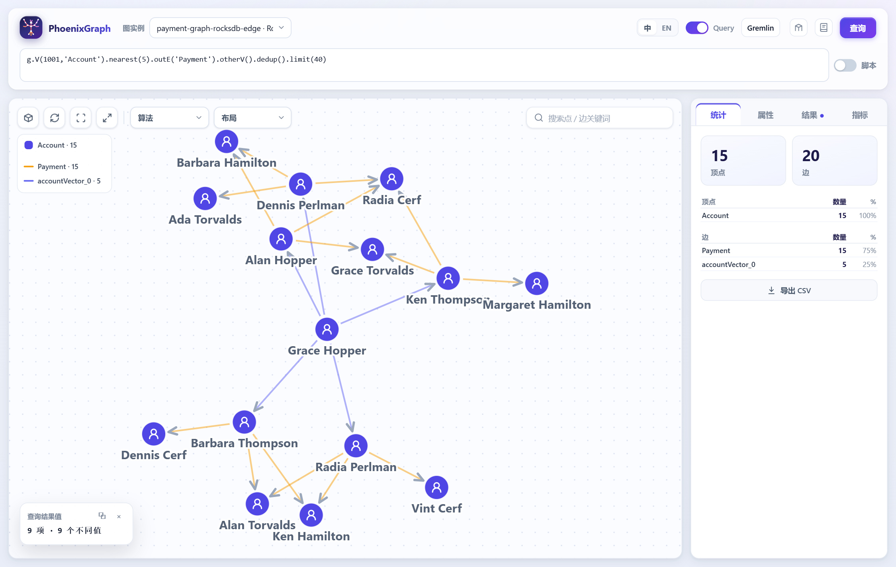

# PhoenixGraph

PhoenixGraph is the context layer an AI agent calls when the answer has to be defensible. Documents go
in; a typed knowledge graph with provenance comes out. Ask it a question and it returns **entities,
directed relations, the sentence each relation was read from, citations and a coverage count** - the
material for a cited answer or an honest refusal, instead of a pile of chunks a model has to guess about.
Agents reach it over MCP or HTTP.

Two properties follow from the design, and they are the whole argument:

- **No language model in the data path.** Extraction is a dictionary plus rule packs, and the default
  embedder is an offline hashing baseline, so the same documents produce the same graph - which is what
  makes an audit possible. A real embedder or reranker plugs in through configuration; the tools do not
  change.
- **The answer shape is a contract.** Every relation carries the sentence it was read from and the citation
  it belongs to, and those citations carry the `chunkId`; every answer carries `coverage`; when the corpus
  does not support a question, the retrieval tools return no relation rather than an invented one, and the
  data agent refuses with the SQL it would have run.

The graph engine underneath is a real database: a graph's schema chooses Aerospike for keyed transactional
reads and writes or RocksDB for ordered scans and analytics, and Gremlin, openCypher and the HTTP API are
the same on both. See [Positioning](docs/POSITIONING.md) for who this is for and what it is not.

## What an agent gets back

`POST /api/v1/agent/context` on the bundled 三国 graph, asking 「关羽和诸葛亮什么关系」 (live response,
fields elided):

```json
{ "coverage": {"entities": 14, "relations": 16, "citations": 4, "seeds": 5, "hops": 1},
  "relations": [
    {"head": "关羽", "relation": "sibling_of", "tail": "刘备", "rule": "is-of",
     "cite": "三国志 · 关羽传（示例文本） §2",
     "sentence": "关羽字云长，是刘备的义弟，也是刘备的臣。"},
    {"head": "诸葛亮", "relation": "strategist_of", "tail": "刘备", "rule": "of-is",
     "cite": "三国志 · 关羽传（示例文本） §2",
     "sentence": "刘备的军师是诸葛亮，诸葛亮的师傅是水镜先生。"}],
  "citations": [{"chunkId": "guanyu#1"}, {"chunkId": "zhugeliang#1"}] }
```

The agent can now walk `关羽 → sibling_of → 刘备 ← strategist_of ← 诸葛亮` and quote both sentences in the
answer. A vector index would have returned the two chunks and left the model to work out how they connect -
and to fill the gap confidently where they do not.

## The three questions it is built for

| Question | What comes back | Without it | Asserted by |
| --- | --- | --- | --- |
| 关羽 and 诸葛亮: how are they related? | 16 relations, each with the sentence it was read from and its citation; `coverage` states what the answer rests on | two chunks with no edges between them | `verify-ai-context.mjs:31,33` |
| What did Deploy 42 cause? Who approved it? | 3 documents become one graph; `payment service` merged from three spellings (`mentions: 3`, `duplicatesRemoved: 2`); two `caused` edges; the approval question returns **0 name matches, 0 relations** - a refusal | three indexes, one per document; a confident guess for the approval | `:64,68,74` |
| Why did spend change? Is ROI an efficiency problem? | `14,754,787.14 → 14,731,149.38`, `delta −23,637.76`, four slices that add up (`decompositionAddsUp: true`); CAC is refused, with the warehouse SQL | a hand-written SQL nobody can check; a ratio answered as a sum | `:82,87` |

Every number above is asserted against a running service by `node verification/verify-ai-context.mjs`. The
full response excerpts and where each number comes from are in the
[one-page case sheet](docs/AI-CONTEXT-ONE-PAGER.md); the longer walkthroughs are
[AI-CONTEXT-CASES.md](docs/AI-CONTEXT-CASES.md), [AGENT-INGESTION-CASE.md](docs/AGENT-INGESTION-CASE.md)
and [END-TO-END.md](docs/END-TO-END.md).

## What it does

**Ingestion with a measured quality report.** Documents become chunks, entities and relations (a
domain dictionary plus a data-driven rule pack), then a graph with vectors. `POST /api/v1/agent/ingest`
is a dry run unless `apply: true`, and always returns the numbers an operator needs before trusting it:
`provenanceRate`, `typeAgreement`, precision/recall against a gold set, `entityLinkRate`,
`duplicatesRemoved` with a `mergedEntities` review list, and `mergeCandidates` for near-duplicates that were
deliberately **not** merged - `POST /api/v1/agent/merge` folds an approved one, rewriting its edges and
recording its name as an alias. [AI toolkit →](docs/AI-TOOLKIT.md)

**Eight retrieval tools, one answer shape.** `context`, `search`, `find_entities`, `related`, `similar`,
`related_similar`, `similar_related` and `path_between` all return the same document - `entities`,
`relations` with their sentences, `citations` with `chunkId`s, `coverage` and `next` - so an agent learns one
shape and a client cannot drift from the service. The MCP server reads the catalog from the API rather than
hard-coding it.

**Data questions answered with a plan, or refused.** The semantic layer (`/api/v1/semantic/*`,
`/api/v1/analysis/*`) returns a metric/dimension plan, the traversal it ran, the warehouse SQL to check it
against and its provenance. A ratio the model cannot execute is refused with the SQL, never estimated.
[DATA-AGENT.md](docs/DATA-AGENT.md)

**Graph and vector search in one traversal.** `nearest(k)` is an ordinary step, so a query can go from
similar accounts to their payments without a client-side join. Geo search is available the same way when
a graph carries coordinates. [Query guide →](docs/QUERY.md)

**HTAP without a second system.** Keyed reads touch one record; analytical questions scan ordered tables;
PageRank, Louvain, connected components and four centralities run in-process or on a Gemini cluster. The
backend is a property of the schema, not of the application code. [Design →](docs/DESIGN.md) ·
[Algorithms →](docs/ALGORITHMS.md)

**Latency on the demo graph.** A one-hop query runs at p50 0.54–3.57 ms (median 0.9 ms), two hops at
1.22–5.16 ms (median 2.3 ms), measured by `AerospikeHopQueryLatencyTest`.

**A UI to see the answer.** The bundled `graph-web` has a Gremlin query editor (openCypher is accepted by
the API), a canvas that draws the returned subgraph, algorithm colouring, tree and DAG layouts, and a
schema builder. [Web UI →](docs/WEB-UI.md)

## Quickstart

You need JDK 21+, Maven 3.9+ (the wrapper works) and Docker. The MCP server and the verification
scripts also need Node.js 18+; the Python client needs Python 3.9+, and the TypeScript client needs Node 18+ to build.

```bash
git clone https://github.com/KanJiaZhang/PhoenixGraph.git
cd PhoenixGraph
tools/start-phoenixgraph.sh
```

The script builds the project, starts Aerospike, the API on `8081` and the UI on `8080`, and waits until
both answer. Open <http://localhost:8080>. Use `--no-build` to skip the build and
`tools/stop-phoenixgraph.sh` to stop everything. `docker compose up --build` runs the same services in
containers; `docker compose down` stops them. On Windows, run the scripts from Git Bash and start Docker
Desktop first.

Try a graph walk, an algorithm and an agent call:

```bash
# the shortest proof: two documents -> a cited answer -> a question the graph cannot support
node examples/three-minute-demo/demo.mjs

# 1. walk five payments from account 135
curl -s -X POST localhost:8081/api/v1/query -H 'content-type: application/json' --data-binary @- <<'EOF'
{"graphName":"payment-graph","query":"g.V(135,'Account').bothE('Payment').otherV().limit(5)","includeResult":true,"returnSubgraph":true}
EOF

# 2. rank the reached accounts
curl -s -X POST localhost:8081/api/v1/query -H 'content-type: application/json' --data-binary @- <<'EOF'
{"graphName":"payment-graph","query":"g.V(135,'Account').bothE('Payment').otherV().pagerank()","includeResult":true}
EOF

# 3. what an agent would ask next
curl -s -X POST localhost:8081/api/v1/agent/context -H 'content-type: application/json' --data-binary @- <<'EOF'
{"graph":"agent-demo","question":"诸葛亮和司马懿是什么关系"}
EOF
```

The two `curl` query calls return the vertices and the `subgraph` block the UI draws. The agent call
returns entities, relations, citations and a `coverage` count. For ingestion, verification and more
examples, see [QUICKSTART.md](QUICKSTART.md).

The one command that proves the AI claims in this README against the running service:

```bash
node verification/verify-ai-context.mjs   # a per-hop-cited path, a cross-document merge, a coverage-based
                                         # refusal, a decomposition that adds up, a refused ratio
```

## See it



This is `g.V(1001,'Account').nearest(5).outE('Payment').otherV().dedup().limit(40)` on
`payment-graph-rocksdb-edge`: five vector-nearest accounts, then their payments, in one traversal. The
picture is drawn by `graph-web` from the query's `returnSubgraph`.

## Using it with an AI agent

Pick the path that matches what you already have:

| You have | Start with |
| --- | --- |
| Documents | Use the document icon in the UI, `POST /api/v1/agent/ingest`, or `node tools/ingest-docs.mjs <dir>` to build a graph with entities, relations, vectors and a quality report. Then call `search`, `context`, `related` or `path_between`. Scanned PDFs use `--ocr` (pdftoppm + tesseract). |
| A schema or a curated graph | Query it directly with Gremlin or openCypher, or use the semantic layer (`/api/v1/semantic/*`) to ask data questions with a plan and provenance. |
| An agent runtime | Connect `tools/mcp-server.mjs` over MCP, or register the 14 tools from `GET /api/v1/agent/tools`. |
| An on-call question (what is most likely wrong?) | [docs/INCIDENT-TRIAGE.md](docs/INCIDENT-TRIAGE.md): four RCAs, a topology, hosts, metrics and a change window become one graph, and a symptom is ranked against the causal edges with the sentence behind each. `node examples/incident-triage/triage.mjs` |

An agent needs three facts from the answer shape: every `relation` carries `sentence` and `cite`; every
answer carries `coverage` (`entities`, `relations`, `citations`, `seeds`, `hops`); and `relations: 0` with no
`via: "name"` entity means **the corpus does not answer this** - a finding a runtime can act on, rather than
a prompt instruction it has to hope the model obeys. `next` names the tools worth calling after this one, so
a runtime can keep going without a hand-written tool graph. The permission for a data answer is a signed
token (plan hash + expiry), so a confirmed plan survives a restart and works across replicas.

MCP over HTTP has the operational bits an agent platform needs, all of them stated in
[docs/AI-TOOLKIT.md](docs/AI-TOOLKIT.md): loopback by default, a bearer token or a per-token tool scope map,
`PHOENIXGRAPH_MCP_AUDIT` (JSONL, one line per `tools/call`) and `PHOENIXGRAPH_MCP_RATE_LIMIT`.

The MCP server is stateless, reads its tool list from the running API, and forwards an API key when the
service is secured. It runs over stdio or HTTP (`--http`); the HTTP endpoint requires a bearer token
and can be limited to a tool allowlist:

```json
{
  "mcpServers": {
    "phoenixgraph": {
      "command": "node",
      "args": ["/path/to/PhoenixGraph/tools/mcp-server.mjs"],
      "env": {
        "PHOENIXGRAPH_API": "http://localhost:8081",
        "PHOENIXGRAPH_API_KEY": "<your-key>"
      }
    }
  }
}
```

`GET /api/v1/agent/tools` advertises fourteen tools - the eight retrieval tools above, plus six data tools
(`semantic_model`, `semantic_translate`, `semantic_validate`, `ask_data`, `analyze_business`,
`attribute_change`). The data tools return a plan, provenance and either an answer or a refusal. Details and
a worked example are in [docs/AI-TOOLKIT.md](docs/AI-TOOLKIT.md); the data-agent contract is in
[docs/DATA-AGENT.md](docs/DATA-AGENT.md).

From Python, install the zero-dependency client with `pip install -e clients/python`, then:

```python
from phoenixgraph import PhoenixGraphClient

client = PhoenixGraphClient("http://localhost:8081")
answer = client.context("agent-demo", "诸葛亮和司马懿是什么关系")
print(answer["coverage"])
```

## Documentation

| Topic | Document |
| --- | --- |
| Positioning, audience, what it is not | [docs/POSITIONING.md](docs/POSITIONING.md) |
| Product plan and batches | [docs/PRODUCT-PLAN.md](docs/PRODUCT-PLAN.md) |
| Three-minute demo | [examples/three-minute-demo/README.md](examples/three-minute-demo/README.md) |
| Business incident demo | [examples/business-demo/README.md](examples/business-demo/README.md) |
| TypeScript client | [clients/typescript](clients/typescript) — build from source; not yet on npm |
| Confluence / Notion / S3 ingestion | [tools/ingest-confluence.mjs](tools/ingest-confluence.mjs) · [tools/ingest-notion.mjs](tools/ingest-notion.mjs) · [tools/ingest-s3.mjs](tools/ingest-s3.mjs) |
| Python client | [clients/python/README.md](clients/python/README.md) |
| Ten-minute walkthrough | [QUICKSTART.md](QUICKSTART.md) |
| Query language, example graphs, loading data | [docs/QUERY.md](docs/QUERY.md) |
| Storage, modules, distributed engine, monitoring | [docs/DESIGN.md](docs/DESIGN.md) |
| Algorithms and centralities | [docs/ALGORITHMS.md](docs/ALGORITHMS.md) |
| AI agent toolkit and MCP | [docs/AI-TOOLKIT.md](docs/AI-TOOLKIT.md) |
| Knowledge graph context and data-agent walkthrough | [docs/USE-CASES.md](docs/USE-CASES.md) |
| Worked analyses and refusals | [docs/AGENT-CASES.md](docs/AGENT-CASES.md) · [docs/DATA-AGENT-CASES.md](docs/DATA-AGENT-CASES.md) |
| Use it from a pi agent (extension / MCP design) | [docs/PI-PLUGIN.md](docs/PI-PLUGIN.md) |
| Incident triage from a symptom — a worked case with the UI and the ranking | [docs/INCIDENT-TRIAGE.md](docs/INCIDENT-TRIAGE.md) · [examples/incident-triage](examples/incident-triage) |
| End-to-end cases (the product in action) | [docs/AI-CONTEXT-ONE-PAGER.md](docs/AI-CONTEXT-ONE-PAGER.md) · [docs/END-TO-END.md](docs/END-TO-END.md) · [docs/AI-CONTEXT-CASES.md](docs/AI-CONTEXT-CASES.md) · [docs/AGENT-INGESTION-CASE.md](docs/AGENT-INGESTION-CASE.md) |
| HTTP API, keys, limits, errors | [docs/API.md](docs/API.md) |
| OpenAPI spec | [docs/OPENAPI.md](docs/OPENAPI.md) · [docs/openapi.json](docs/openapi.json) |
| Backups, HA, upgrades, failure modes | [docs/OPERATIONS.md](docs/OPERATIONS.md) |
| Numbers not to trust | [docs/DATA-QUALITY.md](docs/DATA-QUALITY.md) |
| SLOs and capacity | [docs/SLO.md](docs/SLO.md) · [docs/CAPACITY.md](docs/CAPACITY.md) |
| Benchmark harness and 10⁷ plan | [docs/BENCHMARK.md](docs/BENCHMARK.md) |
| TLS reverse proxy | [deploy/tls/README.md](deploy/tls/README.md) |
| Helm chart | [deploy/helm/phoenixgraph/README.md](deploy/helm/phoenixgraph/README.md) |
| Terraform | [deploy/terraform/README.md](deploy/terraform/README.md) |
| Visualisation options | [docs/WEB-UI.md](docs/WEB-UI.md) · [docs/GRAPH-VISUALIZATION.md](docs/GRAPH-VISUALIZATION.md) |
| 三国 graph and extraction | [SANGUO-KG.md](SANGUO-KG.md) · [SANGUO-KG-TEXT-EXTRACTION.md](SANGUO-KG-TEXT-EXTRACTION.md) · [SANGUO-KG-QUERIES.md](SANGUO-KG-QUERIES.md) |
| TPC-H semantic layer | [TPC-H-ANALYTICS.md](TPC-H-ANALYTICS.md) |
| Release notes and roadmap | [docs/RELEASE-1.1.2.md](docs/RELEASE-1.1.2.md) · [docs/RELEASE-1.1.1.md](docs/RELEASE-1.1.1.md) · [docs/RELEASE-1.1.0.md](docs/RELEASE-1.1.0.md) · [docs/RELEASE-1.0.1.md](docs/RELEASE-1.0.1.md) · [docs/ROADMAP-1.0.md](docs/ROADMAP-1.0.md) |

## Build and test

```bash
./mvnw clean package                     # build everything
./mvnw test                              # 1,100+ tests; store-backed ones skip if Aerospike is down
tools/start-phoenixgraph.sh --no-build   # start API and UI
node verification/run.mjs                # live checks against the running service
node --test tools/connectors/*.test.mjs  # Confluence/Notion connectors (mock servers)
pip install -e clients/python             # once, for the Python client
python -m unittest discover -s clients/python/tests -v   # the Python client, no service needed
(cd clients/typescript && npm ci && npm run build && npm test)   # the TypeScript client
```

`verification/run.mjs --list` shows what each check needs: a running service, Docker, or a Chromium-based
browser. The checks drive the real HTTP API and the real UI, including the numbers quoted in these
documents. The MCP server has its own check: `node tools/mcp-server.mjs --selftest`.

Release tags publish `ghcr.io/<owner>/phoenixgraph-http` and `ghcr.io/<owner>/phoenixgraph-web` through
`.github/workflows/publish-images.yml`. Until a tag is published, build locally with
`docker compose up --build`.

For a fail-closed local stack (API key required, audit on disk, UI key forwarded):

```bash
cp deploy/secure/security.example.yml deploy/secure/security.yml
export PHOENIXGRAPH_DASHBOARD_TOKEN="$(openssl rand -hex 24)"
docker compose -f docker-compose.yml -f docker-compose.secure.yml up --build
```

See [docs/OPERATIONS.md §5b](docs/OPERATIONS.md#5b-running-with-authentication-and-a-durable-audit) for
tenants, TLS and the audit file.

## Status

The current release is [v1.1.2](https://github.com/KanJiaZhang/PhoenixGraph/releases/tag/v1.1.2), a
developer release. It is usable and documented, but not finished. The known limits:

- **Extraction is a dictionary plus rule packs, not a general extractor.** A new domain needs a vocabulary
  and a rule pack (data, loaded from `phoenixgraph.agent.rules-dir`); the seam for a learned extractor
  exists, but nothing ships that reads arbitrary prose. `dictionaryCoverage` and `chunkCoverage` in the
  quality report are what tell you the configuration is thin, before an agent discovers it.
- **The default embedder is an offline hashing baseline.** It is deterministic and needs no key or network,
  and the retrieval evaluation measures it; `phoenixgraph.agent.embedding.provider=http` switches ingestion to
  an OpenAI-compatible `/embeddings` endpoint, and the artifact records the vector space so queries rebuild
  the same one.
- **Authentication is off in the demo profile.** `SPRING_PROFILES_ACTIVE=secure` requires an API key and
  writes the audit to an append-only file; TLS is fronted or configured with `server.ssl.*`. See
  [docs/OPERATIONS.md](docs/OPERATIONS.md#5b-running-with-authentication-and-a-durable-audit).
- **Failover is not automatic.** The store accepts a seed list and a running engine survives losing its seed,
  but there is no leader election or automatic promotion.
- **Demo-scale data.** The examples are 10²–10⁴ vertices. A 10⁶-vertex load was measured (vertices load in ~1 min;
  the CSV edge loader is the ceiling), but there is no published 10⁷-vertex benchmark.
- **A subset of Gremlin and openCypher.** Unsupported syntax is rejected, never silently ignored.
- **RocksDB graphs are loaded, not written over REST.** Bulk loaders fill the ordered tables.

The full list, with the evidence for each item, is in [docs/RELEASE-1.0.0.md](docs/RELEASE-1.0.0.md);
what changed in the current release is in [docs/RELEASE-1.1.2.md](docs/RELEASE-1.1.2.md); what is still
planned is in [docs/ROADMAP-1.0.md](docs/ROADMAP-1.0.md).

## License

Apache License 2.0. See [LICENSE](LICENSE).
