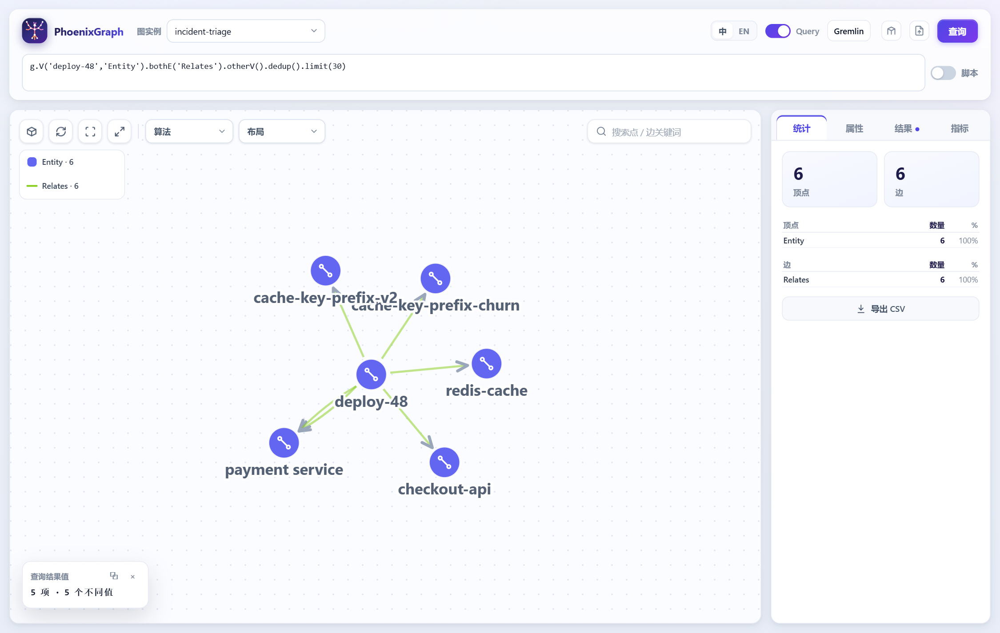
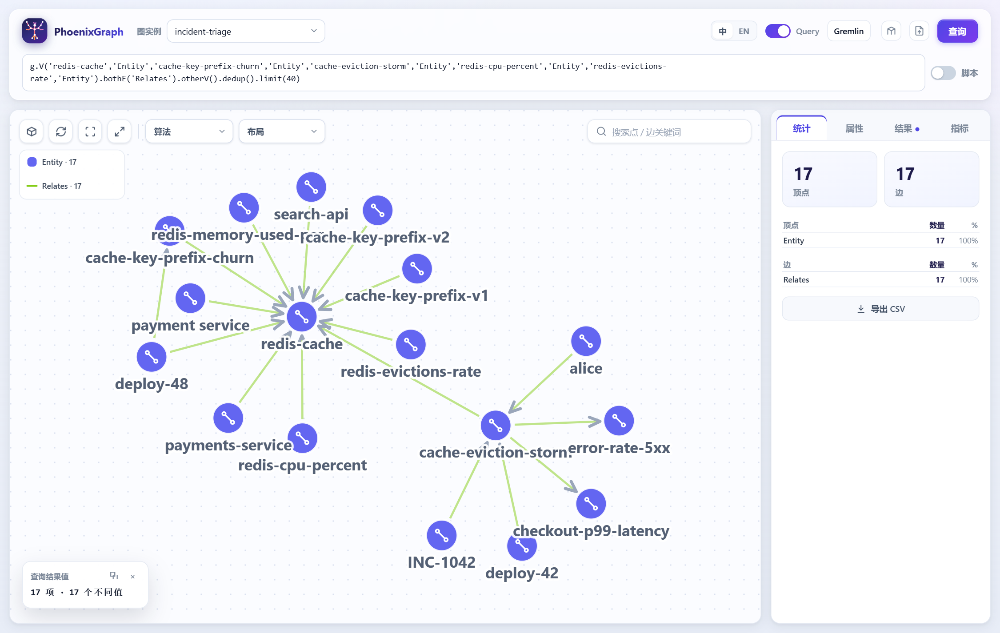
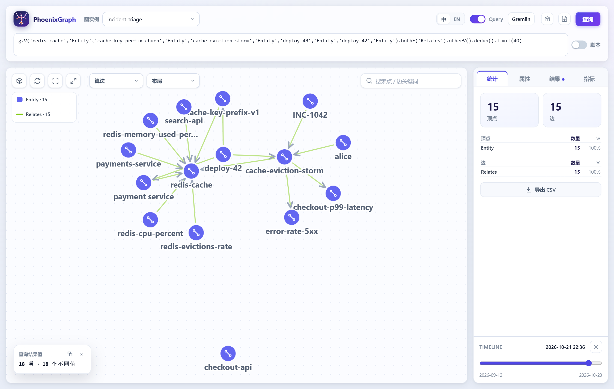
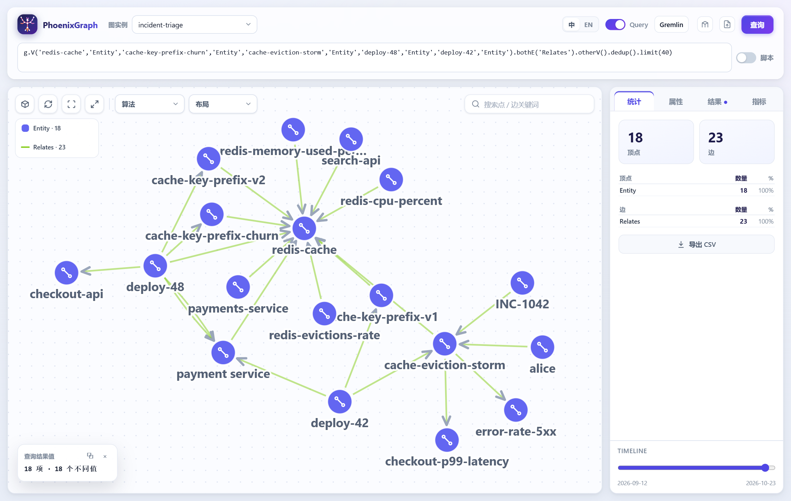

# 案例：从故障现象到最可能的原因（on-call triage）

> 一份可跑的产品案例。四个真实形态的 RCA、一张服务/机器/数据库/指标/发版的关联图、一条故障现象，
> 输出是**排过序的原因假设 + 每条假设的原文句 + 什么会推翻它**。所有响应都来自运行中的服务，
> 每一步都能用仓库里的命令重放。代码在 [`examples/incident-triage`](../examples/incident-triage)，
> 断言在 [`verification/verify-incident-triage.mjs`](../verification/verify-incident-triage.mjs)。

## 0. 先给结论，再讲怎么来的

| | |
|---|---|
| 故障现象 | 2026-10-24 14:32 起 `checkout-api` p99 180ms → 4.2s，`error-rate-5xx` 2.3%；`redis-cpu-percent` 95%、`redis-evictions-rate` 高频抖动、`redis-memory-used-percent` 88%；日志大量 cache miss |
| 最可能的原因 | **deploy-48**（10:00 上线的 payment service 缓存 key 前缀变更）→ `cache-key-prefix-churn` → `redis-cache` 内存/淘汰抖动 → 回源把 checkout 的延迟和 5xx 带上去 |
| 为什么是它 | 唯一一个「失败模式作用在症状指标所观测的组件（`redis-cache`）上、并且变更窗口也碰到 `checkout-api` 和 `redis-cache`」的候选；同时是语料里最新的变更 |
| 历史依据 | `INC-1042`（2026-09-12）是同一形态：`deploy-42` 换缓存前缀 → `cache-eviction-storm` → `redis-cache` |
| 第二名 | `deploy-42`（同形态但老的变更，score 10），第三名 `deploy-47`（checkout 自身发版回归，score 3） |
| 被排除 | `deploy-46`（DNS）→ −3：它作用在 `notification-service` / `rabbitmq`，本次无任何信号 |
| 什么会推翻它 | deploy-48 的发布 diff 里其实没有这个改动；或 redis 指标在 10:00 前就开始恶化；或 5xx 集中在完全不碰缓存前缀的代码路径 |
| 复核 | `examples/incident-triage/triage.mjs --json`（机器可读）、`verification/verify-incident-triage.mjs`（15 条断言）、artifact `incident-triage.agent.json`（每条边带 `sentence` + `chunkId`） |

## 1. 语料：真实 ops 数据长什么样

`examples/incident-triage/documents/` 里是 8 篇：

| 文件 | 内容 | 为什么需要它 |
|---|---|---|
| `10-topology.md` | 服务之间 `depends on` / `uses` | 回答「这个故障可能从哪来」，以及「影响面」 |
| `11-hosts.md` | 服务 `deployed on` 哪台机器，机器 `part of` 哪个资源池 | 排机器/资源池问题，做容量判断 |
| `12-metrics.md` | `redis-cpu-percent affects redis-cache` 等 6 条 | **指标点名组件**——把「指标飙了」变成「某组件可疑」 |
| `20-inc-1042.md` | Redis 淘汰风暴（2026-09-12） | 同形态历史事故，也是本次的「复现」依据 |
| `21-inc-1051.md` | Postgres 连接池耗尽（2026-10-02） | **陷阱**：它和 1042 推高同样两个指标 |
| `22-inc-1063.md` | DNS 解析失败（2026-10-11） | 无关链路，用来验证排序会把它压到负分 |
| `23-inc-1070.md` | checkout 发版回归（2026-10-20） | 另一个真实候选（5xx 也能由它解释） |
| `30-change-window.md` | 今天 10:00 的 deploy-48 改了什么 | 让「最近谁动过」成为一条可查的边，而不是记忆 |

写语料的三条规矩（决定了抽取质量）：

1. **一句话一个事实**，中间空一行。分块器按段落切，一段一句 → 每条关系的 `sentence` 就是那一句原文，
   引用可以精确到 `30-change-window.md §7`。
2. **名字进词典**。词典既给类型（`Service`/`Datastore`/`Host`/`Metric`/`Deploy`/`FailureMode`/`Incident`），
   也是「哪些词算实体」的界。抽取是词典 + 规则，不是模型——**规则读不出的事实，图里就没有**。
3. **用规则包认识的动词**。`incident` 包认识 `caused` / `depends on` / `uses` / `deployed on` /
   `replaced` / `affects` / `part of` / `fixed` / `owns` / `reports`。换个域就加词表和（必要时）规则包。

语料里故意埋了两个坑，因为它们正是真实数据的样子：

- **同一指标签名，两个不同根因**：INC-1042（缓存淘汰）和 INC-1051（连接池耗尽）都推高
  `checkout-p99-latency` 与 `error-rate-5xx`。只比指标的排序器分不开，按「指标属于哪个组件」才分得开。
- **一个服务三种拼写 + 一个近重复**：`payment-service` / `payment service` / `PaymentService` 合并成一个
  实体；`payments-service` 只差一个字符，**不合并**，进 `mergeCandidates` 交人工。

## 2. 步骤一：把语料变成图

```bash
tools/start-phoenixgraph.sh --no-build          # 8081 API（摄取需要 Aerospike 写入路径）
node examples/incident-triage/triage.mjs --reingest
```

`--reingest` 做两件事：删掉上次的 artifact（重建要从零开始），然后 `POST /api/v1/agent/ingest`，
`rulePack: incident`、`apply: true`。响应里的质量报告就是要看的东西：

```
entities:  41        relations: 63        chunks: 80
provenanceRate 100% · typeAgreement 100% · entityLinkRate 100% · dictionaryCoverage 95%
merged:    payment service <- PaymentService, payment-service   (11 次提及，一个节点)
candidates: payment service ~ payments-service (one-character spelling difference)
```

- `provenanceRate 100%` —— 每条关系的原句里真的同时出现两端，这是「可引用」的机械检查。
- `merged` 是确定性合并（大小写/空格/连字符归一），`candidates` 是**没合并**的、等人工决定的近重复。
- 抽出的关系类型分布：`caused 5`、`affects 20`、`deployed_on 10`、`depends_on 7`、`part_of 6`、
  `replaced 3`、`reported 4`、`fixed 4`、`uses 2`、`owns 2`。

图本身是两类顶点、两类边：`Entity` / `Chunk`，`Relates`（实体↔实体，边上带 `relation`、`sentence`、
`chunkId`）和 `Mentions`（chunk→实体）。**边上的句子就是证据**，UI 里点开一条边能看到它出自哪句原文。

> 重复摄取是幂等的：关系的边 id 由 `(head, relation, tail)` 决定（`rel-` + 前 12 字节 SHA-256），
> 所以再跑一次不会多出第二条边。这个性质是 1.1.2 之后修的——之前用 `rel-<序号>`，第二次摄取会写出一批
> 同 id 不同含义的边，图里留下同一份文档的两种读法。

## 3. 步骤二：图里长什么样（UI）

先看**变更窗口本身**——deploy-48 到底碰了什么（`examples/incident-triage` 图，UI 8080）：

```groovy
g.V('deploy-48','Entity').bothE('Relates').otherV().dedup().limit(30)
```



六条边，正好六句原文：`is deployed on payment service`、`replaced cache-key-prefix-v2`、
`caused cache-key-prefix-churn`、`affects checkout-api`、`affects redis-cache`、`affects payment service`。
**这就是「最近谁动过、动了什么」的全部证据**——不是从工单里回忆，是从图里读。

再看**故障签名**：同一个 datastore 上，两次不同时间的失败模式、观测它的指标、以及改动它们的发版：

```groovy
g.V('redis-cache','Entity','cache-key-prefix-churn','Entity','cache-eviction-storm','Entity',
    'redis-cpu-percent','Entity','redis-evictions-rate','Entity').bothE('Relates').otherV().dedup().limit(40)
```



图里能直接读出这次结论的骨架：`redis-cache` 是中心；一边是今天的 `cache-key-prefix-churn`（来自
`deploy-48`）和 9 月的 `cache-eviction-storm`（来自 `deploy-42`，被 `INC-1042` 记录）；另一边是观测它的
三个指标和下游的 `checkout-p99-latency` / `error-rate-5xx`。**「同样的形态、同一个组件」在图里是一条可数的
路径，不是一句感觉。**

## 4. 步骤三：三个问题，三次调用

### 4.1 症状点名了谁（种子）

```bash
curl -s localhost:8081/api/v1/agent/find-entities -H 'content-type: application/json' -d '{
  "graph":"incident-triage",
  "question":"2026-10-24 14:32 起 checkout-api 的 p99 从 180ms 涨到 4.2s，error-rate-5xx 到 2.3%。同时 redis-cpu-percent 到 95%，redis-evictions-rate 高频抖动，redis-memory-used-percent 88%。",
  "k":20}'
```

```
redis-cpu-percent (Metric) · redis-evictions-rate (Metric) · error-rate-5xx (Metric)
checkout-api (Service)     · redis-memory-used-percent (Metric)
```

只用 `via: "name"` 的命中。**向量近邻不算种子**：它只能说明「文本相关」，不能说明「故障涉及」。
如果一条都没命中，脚本直接拒答（见 §6）。

### 4.2 这些指标在观测哪个组件

图里的 `affects` 边就是答案：`redis-*` 三个指标 → `redis-cache`，`error-rate-5xx` → `checkout-api`。
于是「指标飙了」变成两个具名嫌疑人：**redis-cache 和 checkout-api**。

> `affects` 在这个语料里是双重用途：指标 `affects` 它观测的组件，失败模式 `affects` 它破坏的组件。
> `incident` 规则包没有 `observes` 这个动词，为了一个 demo 另造规则包不划算——脚本把
> 「指标 → affects → 组件」读作 observes，并写在这里。

### 4.3 候选原因与打分

候选是图里所有 `caused` 边（5 条）。每条按下表打分，每一项都打印出来：

| 项 | 分 | 运维含义 |
|---|---|---|
| 失败模式作用在**观测到的组件**上 | +6 | 「坏的东西正是这个改动会坏的东西」 |
| 失败模式推动**观测到的指标** | +4 | 部分命中：指标动了，组件关系还差一跳 |
| 失败模式作用在**没有信号的组件**上 | −3 | 这就是 DNS 事故在 checkout 事故当天被压下去的原因 |
| 变更窗口碰到观测组件 | +3/个，上限 6 | 最近谁在附近发过版 |
| 从原因 2 跳内可达观测组件 | +2/个，上限 4 | 拓扑：`deployed_on` / `uses` / `depends_on` 的距离 |
| 有 RCA 记录的同组件同形态前例 | +2 | 复发信号，并且会点出事故编号 |
| 语料里最新 / 次新的变更 | +2 / +1 | 时间序，作为并列时的 tiebreak |

结果（`node examples/incident-triage/triage.mjs` 的真实输出）：

```
#1 deploy-48 -> cache-key-prefix-churn   score 20
    the failure mode acts on redis-cache, which the symptom's metrics observe (+6)
    a change window that touches checkout-api and redis-cache (+6)
    reaches checkout-api and redis-cache within 1 hop(s) (+4)
    INC-1042 (deploy-42 -> cache-eviction-storm) already failed on redis-cache (+2)
    the newest change in the corpus (+2)
    deploy-48 -caused-> cache-key-prefix-churn   "deploy-48 caused cache-key-prefix-churn."
    cache-key-prefix-churn -affects-> redis-cache   "cache-key-prefix-churn affects redis-cache."
#2 deploy-42 -> cache-eviction-storm       score 10
#3 deploy-47 -> checkout-deploy-regression score 3
#4 deploy-45 -> connection-pool-exhaustion score 2
#5 deploy-46 -> dns-resolution-failure      score -3
```

## 5. 步骤四：结论、第二名、以及会推翻它的事实

```
4. Most likely cause
   deploy-48 (score 20), through cache-key-prefix-churn
   It is the only candidate with a change window that touches redis-cache, which is where the symptom's own metrics point.
   The shape is not new: INC-1042 was cache-eviction-storm on redis-cache.
   Runner-up: deploy-42 -> cache-eviction-storm (score 10)

5. What would overturn this
   - deploy-48 did not actually ship the change it claims (check the release diff, not the ticket)
   - the redis-cache / checkout-api signal started before deploy-48 landed (order the metrics by minute)
   - the errors concentrate on a code path that never touches cache-key-prefix-churn (then #2 explains them better)
```

三段话的区别很重要：**结论**是排序第一名，**第二名**是必须给出名字的替代解释（只给一个答案的排序器在复盘会上
没用），**推翻条件**是把结论变成可验证的动作。语料里没有的证据（比如审批记录）就明说不存在，而不是编一个。

## 6. 两个对照：换一天、换一个问题

**换一天（缓存侧安静）**——同一张图，答案应该换：

```bash
node examples/incident-triage/triage.mjs --symptom "2026-10-20 18:10 起 checkout-api 的 error-rate-5xx 从 0.2% 到 2.1%，checkout-p99-latency 到 1.9s；缓存与数据库侧无任何抖动。"
```

```
#1 deploy-47 -> checkout-deploy-regression   score 7
#2 deploy-45 -> connection-pool-exhaustion   score 6
#3 deploy-42 -> cache-eviction-storm         score 6
#4 deploy-48 -> cache-key-prefix-churn       score 4   ← 被降权（redis 无信号 −3），但没有被删掉
```

`deploy-48` 依然在列表里（它确实碰过 `checkout-api`），但它不再是答案：**降权而不是消失**，正是复盘时需要的
那种「我们知道它为什么不是」。

**换一个问题（语料答不了）**——拒答：

```bash
node examples/incident-triage/triage.mjs --symptom "支付网关的 TLS 证书是不是快过期了？"
```

```
1. What the symptom names … nothing: no entity in the graph is named by this symptom.
   Refusing to name a cause. This is the same rule the tools apply to an agent:
   no name match and no relation is a finding, not a prompt to guess.
```

## 7. 复核：为什么这不只是「一段说得通的文字」

| 手段 | 命令 / 位置 |
|---|---|
| 每条边都有原句和 chunk | artifact `incident-triage.agent.json`，UI 里点开边也能看到 |
| 排序是算术，不是模型 | `examples/incident-triage/triage.mjs` 的加分项全部打印 |
| 机器可读的同一份结果 | `--json`（`verification/verify-incident-triage.mjs` 就断言它） |
| 15 条断言 | `node verification/verify-incident-triage.mjs`：拼写合并、近重复留审、第一名、前例、推翻条件、DNS 负分、安静日换答案、未知症状拒答，以及**重复摄取不重复建边** |
| 截图可重建 | `node verification/capture-incident-triage.mjs`（把本文两张图重新画出来） |

## 8. 边界

- **不是诊断**，是「语料支持的假设排序 + 每条假设的原文句 + 什么会推翻它」。图不知道 deploy-48 是无辜的，
  所以它不宣称知道。
- **不是统计**：没有模型、不学习。同一份语料、同一套权重，两个人得到同一份报告——这是它能在复盘会上被
  争论的前提。改权重，分歧就显式化。
- **抽取是词典 + 规则**：换域要加词表，必要时加规则包（`phoenixgraph.agent.rules-dir`）。规则读不出的事实，
  图里就没有；`dictionaryCoverage` / `chunkCoverage` 会先告诉你配置太薄。
- **一个已知的措辞坑**：症状里写「redis 正常」也会被当成命名了 redis 指标。**只贴动了的信号**，别把整块看板贴进
  问题里——这是脚本的限制，不是图的。

## 9. 换成你自己的数据

```bash
# 1. 你的文档（一句话一个事实）+ 词典
node tools/ingest-docs.mjs path/to/your-docs \
  --graph my-ops --rule-pack incident \
  --dictionary my-dictionary.json --apply

# 2. 同一套排序，换图名和症状
PHOENIXGRAPH_TRIAGE_GRAPH=my-ops \
  node examples/incident-triage/triage.mjs --symptom "…"

# 3. 或者不跑脚本，把图直接交给 agent（MCP）
node tools/mcp-server.mjs   # find_entities / context / related / path_between
```

`context` 给 agent 的是同一个形状：实体、带句子的关系、引用、`coverage`。triage 只是把这些边按运维的判断
排了一次序——排序规则留在仓库里，可以被改、被质疑、被替换，这是它和「一个会编故事的助手」的区别。

## 10. 时间维度：图有「有效期」，答案随时间变

一条事实不是永远为真：`deploy-42 replaced cache-key-prefix-v1` 在 2026-10-24 之后就不再成立（v2 换掉了它），
但它不该被删除——它当时是真的。所以点与边除了 `createdTime`/`lastUpdatedTime`（数据库什么时候写的），
还带一个**有效期** `validFrom`/`validTo`（世界什么时候是真的）：`from <= t < to`，两端都可缺省（缺省即无界）。
没有窗口的元素在任何时刻都有效，所以老图的行为完全不变。

### 10.1 语料里怎么写有效期

摄取请求的每个文档可以带窗口（ISO 日期或毫秒）：

```json
{"id":"20-inc-1042","title":"RCA INC-1042 — 2026-09-12",
 "validFrom":"2026-09-12", "validTo":"2026-10-24",
 "text":"…deploy-42 replaced cache-key-prefix-v1.…"}
```

- 拓扑 / 机器 / 指标这类**结构性**事实：不给窗口 → 任何时刻都有效；
- 9 月那次事故描述的是**当时的状态**：`[2026-09-12, 2026-10-24)` —— deploy-48 落地那一刻它失效；
- 变更窗口：`[2026-10-24, ∞)`。

`triage.mjs` 的 `WINDOWS` 表就是这套窗口，摄取后报告 `39 of 63 relations carry a validity window`。
实体取它所有提及所在文档窗口的**并集**——只要有一处结构性提及，它就永久有效。

### 10.2 查询：`asOf` 让「那一刻」成为查询的一部分

| 入口 | 参数 | 行为 |
|---|---|---|
| `POST /api/v1/query` | `"asOf": "2026-10-21"` | 子图里丢掉窗口不含该时刻的点与边（连带丢掉悬空边），Gremlin / Cypher / 脚本都一样 |
| `POST /api/v1/agent/*` | `"asOf": "2026-10-21"` | 8 个检索工具都从**过滤后的 artifact** 召回与扩展，所以 `context` 不会引用已失效的事实 |
| `triage.mjs` | `--as-of 2026-10-21` | 排序用的边也按同一规则过滤，结论与证据不会打架 |

同一张图、不同时刻，答案是不同的（这是时间维度的意义）：

```
$ node examples/incident-triage/triage.mjs --as-of 2026-10-20
#1 deploy-42 -> cache-eviction-storm   score 10     ← 那时 deploy-48 还不存在
$ node examples/incident-triage/triage.mjs --as-of 2026-10-26
#1 deploy-48 -> cache-key-prefix-churn   score 18   ← 9 月的事实已经失效
```

直接查图也能看到：

```
asOf 无        -> 13 顶点 / 16 边   （含 deploy-48）
asOf 2026-10-21 -> 10 顶点 /  8 边   （deploy-48 与它带来的一切都不存在）
asOf 2026-10-26 -> 13 顶点 / 14 边   （deploy-48 在，9 月那条失效了）
```

### 10.3 UI：面板下方的时间轴

图里有带有效期的元素时，右侧面板底部出现时间轴（范围取图的窗口两端）。移动它 → 用同一个查询带 `asOf`
重跑，画布只剩下那一刻有效的点与边；点 `×` 回到最新。截图是把 `redis-cache` 与两个失败模式的邻域画出来，
再把时间轴拖到 **2026-10-21**：`deploy-48` 与 `cache-key-prefix-churn` 消失，只剩 9 月的 `deploy-42` →
`cache-eviction-storm`（被 `INC-1042` 记录）。



在最新时刻的同一张图（时间轴在右端）：



重建截图：`node .logs/capture-timeline.mjs`（开发脚本）或 `verification/capture-incident-triage.mjs`。

### 10.4 边界（v1）

- **过滤发生在答案上，不在遍历里**：一次走查仍可能经过一条已失效的边（它写在图里），但**答案**（子图、
  `context` 的关系、排序用的边）不会包含它。要让遍历本身绕开失效边，需要把窗口下沉到引擎的邻居扩展里。
- **不会自动按句子里的日期赋值**：窗口来自文档（摄取请求），不是从文本里猜出来的。
- 有效期是**声明**，不是历史版本：同一三元组被重写时窗口随之更新（upsert），不会保留旧的窗口。
