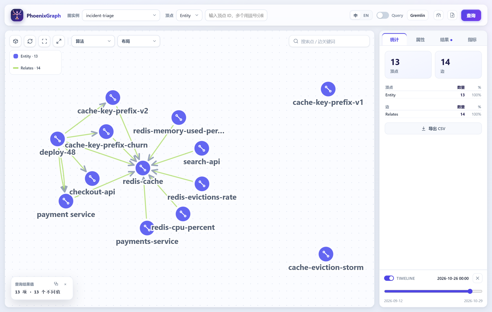

# PhoenixGraph for pi

The pi extension of [`docs/PI-PLUGIN.md`](../../docs/PI-PLUGIN.md), P0 and P1 of that plan:

- **P0 - the tool surface.** Registers `tools/mcp-server.mjs` as an MCP server named `phoenixgraph`, exposed to
  `codemode` so fourteen graph tools are available without crowding the model's context.
- **P1 - the switchboard.** Two tools and one command, plus a *sticky* validity instant: `pg_asof` pins the answers
  to an instant, every later `pg_context` inherits it, and it survives the conversation.

P2 - the ranked answer and the contract. `pg_triage` ranks the causes a symptom supports (the weights live in
[`tools/triage.mjs`](../../tools/triage.mjs), one implementation shared with the MCP server and the example), and a
short `phoenixgraph` prompt **section** carries the graph, the instant, the tools and the answer contract - added
only when the session is actually about a graph, and switchable with `/pg inject on|off`.

P3 - distribution: the package manifest (`pi.extensions` + the `pi-package` keyword, so `pi install` works), the
MCP transport as a session decision (`/pg mcp stdio|http <url>`, with the bearer token from
`PHOENIXGRAPH_MCP_TOKEN`), and a committable `.pi/phoenixgraph.json` so a team starts on the same graph.

Not here yet: `/pg ingest` (a write path belongs behind a human command, and the design lists it as such).

## Install

Simlink or copy this directory into the agent directory, or load it for one run:

```bash
# per user: ~/.pi/agent/extensions/phoenixgraph -> this directory
ln -s "$(pwd)/extensions/phoenixgraph" ~/.pi/agent/extensions/phoenixgraph   # POSIX
# mklink /D "%USERPROFILE%\.pi\agent\extensions\phoenixgraph" "%CD%\extensions\phoenixgraph"   (Windows)

# or for a single session
pi --extension ./extensions/phoenixgraph/index.js
```

The MCP server path is resolved from this file (`../../tools/mcp-server.mjs`), so a symlink still finds the
repository; set `PHOENIXGRAPH_REPO` when the extension is copied somewhere else.

## What it adds

| Surface | Name | What it does |
|---|---|---|
| tool | `pg_context(question, k?, hops?, asOf?, graph?)` | entities, relations with the sentence each was read from, citations and a coverage count - the same document `POST /api/v1/agent/context` returns, rendered for a model |
| tool | `pg_asof(instant?, on?)` | pins the answers to an instant (`2026-10-21`), clears it (`on: false`), or reports it |
| tool | `pg_triage(symptom, asOf?, graph?)` | ranks the causes the symptom supports: score, reasons, the sentence behind each causal edge, the documented precedent, and what would overturn it |
| command | `/pg status` | graph, endpoint, the pinned instant, the last question asked |
| command | `/pg graph <name>` · `/pg endpoint <url>` | which graph and which service this session talks to |
| command | `/pg timeline on\|off\|<instant>` | the same switch as the tool, from the keyboard |
| MCP | `phoenixgraph` | the fourteen tools of the toolkit (`find_entities`, `search`, `context`, `related`, `similar`, `path_between`, the semantic layer), `codemode`-exposed |

The instant is **sticky**, and that is the point: a question that does not name one answers with the session's,
so "what was true then" is a property of the conversation rather than a parameter the model has to remember.
`pg_context` reports the instant it answered with, and the coverage it rests on.

## State: three lifetimes

| Where | What | Lifetime |
|---|---|---|
| `pi.appendEntry("phoenixgraph.state", …)` | graph, endpoint, instant, timeline switch | the conversation, branch-safe, never sent to the model |
| `~/.pi/agent/state/phoenixgraph.json` | the same fields | across conversations (`PHOENIXGRAPH_STATE_FILE` overrides) |
| `<repo>/.pi/phoenixgraph.json` | `graph`, `endpoint` | the repository - a team pinning a service; it deliberately cannot set the instant |

On `session_start` the file is read, then the last state entry **on the current branch** wins, so `/tree` and
resume give the instant that branch was asking from. Nothing is written outside those two places.

## Verify it

```bash
node --test extensions/phoenixgraph/test/*.test.mjs   # 26 assertions, no pi, no service (a fake pi/fetch)
```

What the tests pin: the MCP server is registered and `codemode`-exposed, both tools and `/pg` exist, an instant is
normalised (`2026-10-21` -> `2026-10-21T00:00:00.000Z`) and a bad one is refused with the shape it wants,
`pg_context` inherits the pin and quotes the sentence and coverage, a per-call `asOf` overrides without moving it,
`on: false` clears it and stops sending it, the file carries the pin into a new conversation and a branch overrides
the file, a project file pins the graph but not the instant, `/pg` reports status, an unreachable service is
explained instead of thrown, and a question that names nothing is reported as a refusal. P2 adds: `pg_triage` ranks and quotes the sentence,
it answers as of the pinned instant (a later release is not a candidate), a symptom that names nothing is a
refusal the model is told not to override, and the contract section appears only for a graph-aware session and
disappears with `/pg inject off`.

Verified once in pi itself (`pi --extension ./extensions/phoenixgraph/index.js -p "…"`): the model pinned
2026-10-21, asked `pg_context`, and answered with the relation, its sentence and `coverage: 16 entities, 19
relations, 52 citations`; a second, fresh process reported the same pin from the state file.

## Seeing it: `/pg show`

An answer in a transcript is a list; the relations it rests on are a graph. `/pg show` opens the UI at exactly the
context the last answer used - the graph, the traversal over the entities the answer seeded on, and the instant the
answer was pinned to - because the UI accepts a link:

```
http://localhost:8080/?graph=incident-triage&q=g.V('redis-cache','Entity',…)&asOf=2026-10-26T00:00:00.000Z
```

The opener is the platform's (`start` / `open` / `xdg-open`); when it fails, the URL and the query are printed so
they can be pasted. `/pg show <entity>` shows one entity's neighbourhood instead of the last question's.

**With nothing asked yet** it shows the graph's most connected entities instead of an empty canvas: the engine has
no full scan (a start is ids or a type scan), so a `/pg show` before any `pg_context` used to open
`g.V().limit(0)` - a blank page. The seeds come from the artifact now, and the notice says so
(`from: nothing asked yet - the 4 most connected entities of 'incident-triage'`). If the graph has no artifact at
all, it opens the UI without a query and says to ingest it.



## Remembering a conversation

A conclusion reached in a transcript is reachable by the next model only if someone pastes it back. `/pg remember`
turns the session into a document - the user and assistant turns, oldest first, system prompt and tool output left
out - and ingests it with a validity window that **starts now**, into the session's graph:

```
/pg remember
remembered into 'incident-triage':
4 entities, 1 relations from 1 document(s) (2 chunks)
provenanceRate 1 · typeAgreement 1 · entityLinkRate 0.05
```

What comes back is what the extraction rules can read, and the report says so rather than implying more:

- every turn is now a **chunk with a citation**, so a later answer can quote the conversation;
- sentences written in the pack's vocabulary (`caused`, `depends on`, `uses`, `deployed on`, `affects`, ...)
  become **entities and relations** - prose like "I think the cache is unhappy" does not;
- the gazetteer is the graph's own entities, so a known name keeps its type instead of being re-guessed.

`/pg note "checkout-api depends on redis-cache."` records one fact without the transcript - usually what you want
after a long debugging session. The model can do the same through `pg_remember`, which is how "write down what we
learned" survives a `/compact`.

Because the graph is the one every session of this project uses, the next session sees it: verified by remembering
in one `pi -p` and asking in a fresh one, which answered `checkout-api -depends_on-> payment service` with the
sentence it came from.

## Ingesting documents, by hand

`/pg ingest <path>` reads local Markdown/text and posts it to the ingest API. It is a command and not a tool on
purpose: **writing to a graph is a human decision**, so the model cannot do it while answering a question.

```
/pg ingest docs/runbooks                 # dry run: the whole pipeline runs, nothing is written
/pg ingest docs/runbooks --apply --from 2026-10-24
ingested 2 document(s) into 'incident-triage'
4 entities, 3 relations from 2 document(s) (2 chunks)
provenanceRate 1 · typeAgreement 1 · entityLinkRate 0.5
```

- A file, or a directory walked three levels deep; `.md .markdown .txt .text .html .htm .csv .yaml .yml .log`.
  Images, PDFs and anything else are listed as skipped rather than silently dropped (PDF goes through
  `tools/ingest-docs.mjs --ocr`).
- Caps: 50 files and 2 MB per call, so a mistyped `/` cannot post a repository.
- `--from`/`--to` give every document a validity window; without them the facts hold at every instant.
- The gazetteer is the graph's own entities plus a `dictionary.json` next to the documents, if there is one.
- An empty directory posts nothing and says so.

## Limits

- `pg_context` is a thin, honest wrapper: it does not rank, summarise or fill gaps. When the graph has no relation
  it says so and the model is told not to guess (the P2 contract makes that explicit).
- The instant is a **declaration of fact time**, not a snapshot of rows: an element without a validity window is
  valid at every instant, and expires only if the ingestion gave it one.
- **A remembered sentence is not a verified one.** The ingest keeps the sentence it read, so a note carries the
  provenance of "asserted in a conversation", not "read from documentation" - the model is right to say so.
- Remembering does not replace re-ingesting: the corpus documents are still the source of the facts that came with
  a rule pack and a window. `/pg remember` adds to the graph; it never deletes.
